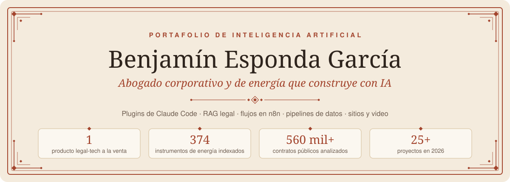
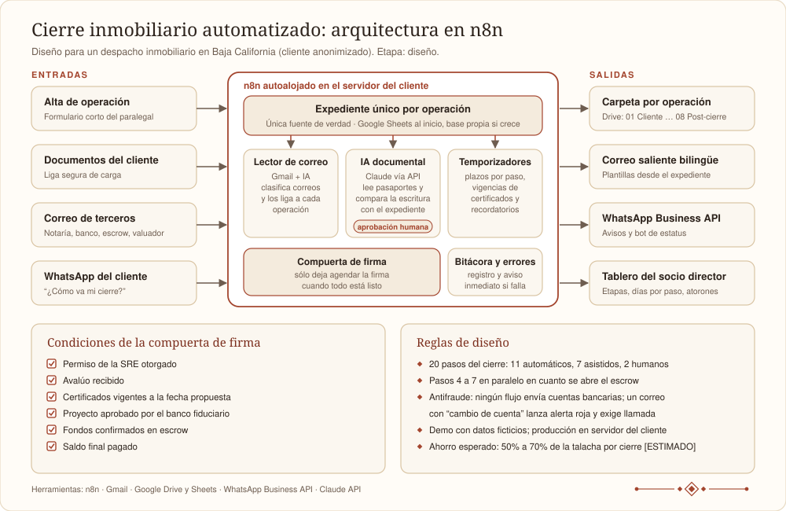

<p align="center"></p>

**Abogado corporativo mexicano (energía, hidrocarburos y minería, unos 8 años de práctica) que construye con inteligencia artificial.** Escribo el análisis legal y armo los sistemas alrededor de él y más allá: plugins y agentes en Claude Code, búsqueda sobre texto legal, flujos en n8n, pipelines de datos en Python, sitios web, video y agentes de IA para marketing.

Ciudad de México · beg.empleos@gmail.com · [pivotek.mx](https://pivotek.mx) · Español (nativo), inglés (profesional) · [English version](README.md) · PDF en [`pdf/`](pdf/)

> **Uso la IA todos los días.** Este portafolio es una muestra, no una lista completa: hay proyectos confidenciales y otros que todavía no salen. El trabajo para clientes está anonimizado: se quitaron nombres, cifras y datos que los identifiquen. Nada en este repositorio constituye opinión legal.

<p align="center"></p>

## Contenido

1. [En breve](#1-en-breve)
2. [Mapa de habilidades de IA](#2-mapa-de-habilidades-de-ia)
3. [Destacado: Con Criterio, kit de IA para abogados mexicanos](#3-destacado-con-criterio-kit-de-ia-para-abogados-mexicanos)
4. [Destacado: motor de búsqueda sobre derecho energético mexicano (RAG)](#4-destacado-motor-de-búsqueda-sobre-derecho-energético-mexicano-rag)
5. [Destacado: inteligencia de compras públicas para petróleo y gas](#5-destacado-inteligencia-de-compras-públicas-para-petróleo-y-gas)
6. [Destacado: automatización del cierre inmobiliario en n8n](#6-destacado-automatización-del-cierre-inmobiliario-en-n8n)
7. [Resumen diario del DOF para el sector energético (n8n)](#7-resumen-diario-del-dof-para-el-sector-energético-n8n)
8. [Trabajo legal y regulatorio hecho con IA](#8-trabajo-legal-y-regulatorio-hecho-con-ia)
9. [Sitios web, video y marketing digital con IA](#9-sitios-web-video-y-marketing-digital-con-ia)
10. [Conectores: cómo automatizo, consulto y genero](#10-conectores-cómo-automatizo-consulto-y-genero)
11. [Herramientas y sistemas](#11-herramientas-y-sistemas)
12. [Estudios de viabilidad](#12-estudios-de-viabilidad)
13. [Formación y comunidad](#13-formación-y-comunidad)
14. [Cómo trabajo con IA](#14-cómo-trabajo-con-ia)
15. [Herramientas técnicas](#15-herramientas-técnicas)

<p align="center"></p>

## 1. En breve

- **IA todos los días:** la uso a diario en trabajo legal, productos, automatización y contenido, y me mantengo a la vanguardia de las herramientas y funciones nuevas. Lo que sigue es una muestra; hay proyectos confidenciales y otros que todavía no salen.
- **Más de 25 proyectos en 2026**, desde auditorías regulatorias internacionales hasta un producto legal-tech a la venta.
- **Un producto en vivo:** Con Criterio, guía con 7 plugins y 7 skills para abogados en México, en ediciones para Claude y ChatGPT, a la venta en [concriterio.mx](https://concriterio.mx) desde el 5 de noviembre de 2026.
- **Búsqueda sobre texto legal:** 374 instrumentos de derecho energético divididos en 11,112 fragmentos según la jerarquía de la norma mexicana, con búsqueda híbrida y un juego de pruebas de regresión.
- **Datos a escala:** un pipeline sobre más de 560,000 contratos de compras públicas para mostrar a proveedores de petróleo y gas dónde está el dinero.
- **Sitios, video y marketing:** cuatro sitios en vivo ([concriterio.mx](https://concriterio.mx), [pivotek.mx](https://pivotek.mx), [casalegado.mx](https://casalegado.mx) y [carocomunicando.com](https://carocomunicando.com)), un video de entrada a escenario para una conferencista, un pipeline automático de Reels y redes sociales operadas por agentes de IA (Grok Bot y Muse de Meta).
- **Herramientas conectadas:** Stripe, Gmail, Google Calendar y Drive, Vercel, Higgsfield, Apify, Canva y automatización del navegador, todo desde Claude Code.
- **Automatización con criterio:** todo flujo deja a una persona en el circuito cuando hay firmas, dinero o juicio legal de por medio.

<p align="center"></p>

## 2. Mapa de habilidades de IA

| Habilidad | Qué he construido con ella |
|:-----|:-------------|
| Agentes de IA y flujos agénticos | Plugins, skills y subagentes de Claude Code para siete materias del derecho mexicano ([§3](#3-destacado-con-criterio-kit-de-ia-para-abogados-mexicanos)); un sistema multiagente de nueve roles con señales tipadas ([§11](#11-herramientas-y-sistemas)); redes sociales operadas por Grok Bot y Muse de Meta ([§9.4](#94-redes-sociales-operadas-por-agentes-de-ia)) |
| Búsqueda sobre documentos (RAG) | RAG legal con embeddings especializados en derecho, pgvector y ranking híbrido sobre 374 instrumentos de energía ([§4](#4-destacado-motor-de-búsqueda-sobre-derecho-energético-mexicano-rag)) |
| Ingeniería de datos | Un pipeline sobre más de 560,000 contratos de compras públicas con actualización semanal y auditorías ([§5](#5-destacado-inteligencia-de-compras-públicas-para-petróleo-y-gas)); modelos financieros en Python y Excel ([§12](#12-estudios-de-viabilidad)) |
| Automatización de procesos | Diseños en n8n para un cierre inmobiliario de 20 pasos y un resumen diario del DOF ([§6](#6-destacado-automatización-del-cierre-inmobiliario-en-n8n), [§7](#7-resumen-diario-del-dof-para-el-sector-energético-n8n)); tareas programadas para la revisión regulatoria mensual y la revisión semanal del segundo cerebro ([§3](#3-destacado-con-criterio-kit-de-ia-para-abogados-mexicanos), [§11](#11-herramientas-y-sistemas)) |
| IA para el trabajo legal | Auditorías regulatorias internacionales, revisiones de contratos y de cumplimiento, dictámenes y cartas, cada dato con fuente y fecha de corte ([§8](#8-trabajo-legal-y-regulatorio-hecho-con-ia)) |
| Construcción de productos | Con Criterio, del contenido al cobro, la entrega automática y las pruebas con compradores simulados ([§3](#3-destacado-con-criterio-kit-de-ia-para-abogados-mexicanos)) |
| Desarrollo web | concriterio.mx, pivotek.mx, casalegado.mx y carocomunicando.com ([§9.1](#91-sitios-web)) |
| Video y contenido con IA | Un video de entrada a escenario con locución de IA y motion graphics, y un pipeline automático de Reels con transcripción local y visión por computadora ([§9.2](#92-video-de-entrada-de-la-conferencista-y-videos-de-eventos), [§9.3](#93-pipeline-automático-de-reels)) |
| Marketing con IA | Más de una docena de skills de marketing y creatividad aplicados a campañas reales, auditorías SEO y textos de anuncios ([§9.5](#95-skills-de-marketing-y-cómo-los-apliqué)) |
| Integraciones (conectores MCP) | Stripe, Gmail, Google Calendar y Drive, Vercel, Higgsfield, Apify, Canva y más de 10,000 acciones de navegador ([§10](#10-conectores-cómo-automatizo-consulto-y-genero)) |
| Criterio y calidad | Compuertas de aprobación humana, reglas antifraude, incertidumbre etiquetada, pruebas golden y construcción reproducible ([§14](#14-cómo-trabajo-con-ia)) |
| Aprendizaje continuo y comunidad | Licenciatura en Derecho (Ibero), Maestría en Derecho de la Empresa (Anáhuac) y MBA (EAE Madrid); uso diario de la IA y de las herramientas nuevas en cuanto salen; cursos gratuitos de Anthropic y Harvey; la comunidad Tododeia; pláticas y workshops de Claude y Grok Bot; cenas de networking con CTOs ([§13](#13-formación-y-comunidad)) |

<p align="center"></p>

## 3. Destacado: Con Criterio, kit de IA para abogados mexicanos

**Qué es.** Un kit práctico de IA para abogados en México: una guía (116 páginas en la edición Claude y 134 en la edición ChatGPT), 7 plugins por materia y 7 skills de redacción. A la venta en [concriterio.mx](https://concriterio.mx) desde el 5 de noviembre de 2026. Desde el 11 de noviembre también ofrece una guía de IA para principiantes, para el público general.

| Plugin | Qué cubre |
|:----|:------------|
| Protección de datos | LFPDPPP: avisos de privacidad, contratos de encargo, transferencias, riesgo de infracción, defensa ante la autoridad |
| Corporativo | LGSM: actas de asamblea, auditoría de estatutos, poderes, due diligence societaria, reestructuras paso a paso |
| Marcas | LFPPI: registrabilidad, oposiciones, nulidad y caducidad, infracciones, plazos ante el IMPI |
| Derecho de autor | LFDA: dictámenes de titularidad, cláusulas de transmisión, limitaciones, aviso y retiro, obras hechas con IA |
| Contratos mercantiles | Código de Comercio y LGTOC: redacción y revisión, pagarés, operaciones de crédito y fideicomiso, intereses y usura, rutas de cobro |
| Energía | Leyes de energía de 2025: ruta de permisos, proyectos eléctricos y de hidrocarburos, sanciones, comparativo 2014 contra 2025 |
| Notariado CDMX | Ley del Notariado y Ley Registral: requisitos de la escritura, testamentos y voluntad anticipada, sucesión ante notario |

**Skills de redacción:** arrendamiento en CDMX, NDA bilateral, comisión mercantil, servicios profesionales, carta de intención, carta poder simple y calculadora de finiquito.

**Cómo se hizo.**

- Cada plugin es un conjunto de skills de Claude Code apoyado en un corpus curado de leyes y criterios judiciales verificados, con un formato único de cita, etiquetas de dato y un bloque de validación que corre antes de entregar cualquier respuesta.
- La guía de la edición Claude trae 115 afirmaciones verificadas y 46 capturas. La edición ChatGPT se adaptó con pasos de instalación para Windows.
- Un monitor en Python lee el DOF con el servicio de datos abiertos del gobierno y marca lo que toca a las leyes que cubre el producto. Una tarea programada corre una revisión regulatoria el día 1 de cada mes.
- Venta y entrega: página de venta, ligas de pago y webhook de Stripe, y un Worker de Cloudflare que entrega los archivos y opera el boletín (101 pruebas automáticas sin fallas).
- Su propia capa legal: términos y condiciones, aviso de privacidad y licencia de uso.
- Pruebas como comprador: una ronda simulada con 20 compradores dio 118 hallazgos distintos y cero bloqueantes; 114 de los 115 hallazgos abiertos se cerraron el mismo día.
- Marketing: contenido producido con Claude Code y publicado por agentes de IA ([§9.4](#94-redes-sociales-operadas-por-agentes-de-ia)), auditoría SEO, dos campañas de Google Ads preparadas y el Pixel de Meta conectado al flujo de pago.

<p align="center"></p>

## 4. Destacado: motor de búsqueda sobre derecho energético mexicano (RAG)

**Problema.** Las reglas de energía en México están dispersas entre el DOF y los sitios de ocho autoridades, y la reforma de 2025 sustituyó buena parte del marco. Encontrar el instrumento que de verdad aplica, y saber si sigue aplicando, toma horas.

**Qué construí.** Un pipeline que recopila, estructura e indexa la legislación energética mexicana para consultarla en lenguaje natural.

| Etapa | Cómo funciona |
|:---|:------------|
| Recopilación | Scrapers asíncronos sobre el DOF y los sitios de los reguladores, con pausas entre solicitudes |
| Extracción | Texto de los PDF con respaldo de OCR para documentos escaneados |
| Segmentación | Divide el texto según la jerarquía de la norma mexicana (título, capítulo, artículo) y no por tamaño fijo |
| Almacenamiento | PostgreSQL con pgvector: documentos y fragmentos, marca de vigencia y una nota de vigencia para normas formalmente vigentes pero suspendidas en la práctica |
| Embeddings | Voyage AI `voyage-law-2`, hecho para texto legal |
| Búsqueda | Ranking híbrido (similitud vectorial y palabras clave, combinadas con reciprocal rank fusion), sinónimos, detección de leyes y ponderaciones |
| Respuestas | Claude contesta preguntas en lenguaje natural sobre los fragmentos recuperados |
| Calidad | Juego de pruebas "golden" como barrera de regresión (9 de 9) y auditorías de la base por duplicados, vigencia y fechas de publicación |

**Escala (abril de 2026).** 374 documentos y 11,112 fragmentos, todos con embedding: 352 vigentes y 22 abrogados, de la CRE, la SENER, el CENACE, la CNH, el CENAGAS, la CNE, la ASEA y el Congreso. Sin LangChain ni LlamaIndex: Python y SQL directos.

<p align="center"></p>

## 5. Destacado: inteligencia de compras públicas para petróleo y gas

**Problema.** Los proveedores del sector de petróleo y gas en México licitan a ciegas: no saben quién compra lo que venden, a qué precio ni cuándo.

**Qué construí.** SupplySense, una herramienta de inteligencia de precios con datos de compras públicas.

- Carga de más de 560,000 contratos de CompraNet (2023 a 2025) en 26 categorías, más 150,000 contratos recientes de ComprasMX obtenidos con Playwright.
- Descarga semanal automática con eliminación de duplicados; datos enriquecidos con geografía y orden de gobierno; ligas por subsidiaria de PEMEX.
- Tablero con indicadores, listas de seguimiento, filtros por giro, búsqueda global y exportación a CSV y PDF; multi-cliente básico.
- Auditorías de datos que detectaron y corrigieron categorías mal clasificadas y valores atípicos, y un análisis del tamaño de mercado (TAM).

<p align="center"></p>

## 6. Destacado: automatización del cierre inmobiliario en n8n



**Problema.** Un despacho inmobiliario en Baja California cierra compraventas de extranjeros a través de fideicomisos bancarios. Cada cierre tiene 20 pasos y depende de la notaría, el banco fiduciario, el valuador, el escrow y el Registro Público. La mayor parte del tiempo de los abogados se va en perseguir documentos y contestar "¿cómo va mi cierre?".

**Diseño.**

- Un expediente único por operación alimenta todos los correos, documentos y avisos.
- 11 de los 20 pasos pueden correr casi solos, 7 quedan asistidos y 2 siguen siendo humanos: la revisión jurídica del proyecto de escritura y la firma ante notario.
- Los pasos 4 a 7 (permiso de la SRE, proyecto de escritura, avalúo y certificados) arrancan en paralelo en cuanto se abre el escrow, lo que podría ahorrar de 7 a 10 días por cierre [ESTIMADO].
- La IA documental lee pasaportes y certificados y compara el proyecto de escritura con el expediente, siempre con aprobación humana.
- Una compuerta de firma impide agendar el cierre hasta que se cumplen seis condiciones, entre ellas que los certificados sigan vigentes a la fecha propuesta y no sólo a hoy.
- Antifraude: ningún flujo envía cuentas bancarias, y cualquier correo sobre cambio de instrucciones de pago lanza una alerta roja y exige llamada de verificación.
- Los datos del cliente nunca viven en mi infraestructura: la demo corre con datos ficticios y la producción va en el servidor propio del despacho.

| Pieza | Qué es | Herramienta |
|:----|:-----------|:------|
| Expediente único | Una fila por operación con compradores, unidad, banco, notaría, escrow, fechas de cada paso, vigencias y estatus | Google Sheets al inicio; base de datos propia si crece el volumen |
| Carpeta por operación | Estructura fija creada sola: de 01 Cliente a 08 Post-cierre | Google Drive |
| Correo saliente | Plantillas bilingües para cliente, notaría, banco, valuador, HOA y escrow, llenadas desde el expediente | Gmail |
| Lector de correo entrante | Clasifica los correos de terceros, los liga a la operación, guarda adjuntos y mueve el estatus | Gmail e IA |
| WhatsApp | Avisos, recordatorios y un bot que contesta "¿cómo va mi cierre?" desde el expediente | WhatsApp Business API |
| IA documental | Lee pasaportes y certificados, compara el proyecto de escritura, resume videollamadas y comentarios del banco | API de Claude, con aprobación humana |
| Temporizadores y compuertas | Plazos por paso, vigencia de certificados y compuerta de firma | n8n |
| Tablero del socio director | Operaciones por etapa, días en cada paso, quién está atorando, alertas | Google Sheets o Looker Studio |
| Bitácora y errores | Registro de cada ejecución y aviso inmediato si un flujo falla | n8n |

**Estatus.** Etapa de diseño (noviembre de 2026). Propuesta entregada; decisiones en un registro de decisiones; implementación planeada en 4 fases de 10 a 13 semanas [ESTIMADO], empezando con un piloto en un solo desarrollo. Ahorro esperado: de 50% a 70% de las horas de talacha por cierre [ESTIMADO], a medir en el diagnóstico.

<p align="center"></p>

## 7. Resumen diario del DOF para el sector energético (n8n)

**Problema.** Cada mañana revisaba el DOF a mano para ver si salió algo que afectara a mis clientes de energía: unos 30 minutos al día [ESTIMADO].

```text
Schedule (lun a vie, 8:30) → HTTP Request (índice del día) → HTML (título, dependencia, liga)
  → Filter (palabras y dependencias de energía) → Aggregate → LLM (una frase + prioridad) → Gmail
```

**Resultado.** Un correo diario con las publicaciones de energía ordenadas por prioridad, unas 100 horas al año de ahorro [ESTIMADO]. El flujo me dice qué leer; leerlo sigue siendo mi trabajo. Se hizo como primera entrega de un curso de automatización con n8n, con el prompt documentado y un plan de manejo de errores.

<p align="center"></p>

## 8. Trabajo legal y regulatorio hecho con IA

Todos los asuntos están anonimizados.

| Asunto | Qué entregué | Cómo se usó la IA |
|:-----|:--------|:-------|
| Entrada a Arabia Saudita de tres contratistas mexicanos del sector energético (ductos, construcción industrial, sistemas contra incendio costa afuera) | Auditorías de empresa y rutas de entrada: por cuál línea de negocio, por cuál puerta y qué la detiene hoy. Hallazgo clave: el obstáculo casi nunca fue la demanda, sino certificaciones faltantes o un modelo de intermediación que el dueño extranjero de la tecnología puede saltarse vendiendo directo en el Golfo | Investigación con fuentes oficiales descargadas por categoría; cada dato con fuente y fecha de corte; un mismo marco regulatorio saudita reutilizado en los tres expedientes; scripts que regeneran los PDF |
| Exportación de carne de bovino a Arabia Saudita (grupo cárnico del sureste) | Ruta regulatoria (autoridad sanitaria saudita, certificación halal, SENASICA), presentaciones de mercado para Arabia Saudita y Asia, y consultas directas a autoridades de ambos países | Investigación y redacción con Claude; un prompt reutilizable para investigar pendientes |
| Contrato de servicios petroleros a 10 años con un ministerio de energía centroamericano | Mapa de obligaciones, plazos críticos, compliance interno, alertas operativas y observaciones al análisis del propio cliente | Extracción estructurada del contrato a un archivo de contexto; entregables en Word |
| Guía de cumplimiento publicitario para productos de salud al consumidor (empresa global) | Verificación de cada fuente citada (guías de COFEPRIS, NOM, códigos de la industria), 19 recomendaciones y versión 3 de la guía con control de cambios y 8 comentarios de validación | Textos oficiales descargados y convertidos a texto plano para cotejo; reporte con semáforo por sección |
| Respuesta institucional de una dependencia estatal a una cadena hotelera internacional | Tres versiones de la carta bajo reglas estrictas de redacción: no admitir, no disculparse, no ofrecer, no tocar temas vedados | Reglas de redacción escritas como restricciones; un script regenera los tres entregables |
| Due diligence de un permiso de comercialización de petrolíferos | Verificación del permiso, su resolución, la firma electrónica y el QR, y los padrones públicos del SAT; one-pager | Verificación de fuentes y one-pager en HTML y PDF |
| Dictamen de viabilidad de marca para un despacho | Dictamen preliminar de registrabilidad conforme a la LFPPI | Hecho con mi propio plugin de marcas |
| Propuesta de una comercializadora de combustibles a la ANH de Colombia | Análisis crítico de una presentación institucional de 33 láminas | Análisis con Claude sobre la presentación |
| Nota técnica sobre IA en el sector energético para el Senado de la República | Nota técnica y carta de presentación a un senador | Investigación y redacción con Claude; Markdown a PDF |

<p align="center"></p>

## 9. Sitios web, video y marketing digital con IA

### 9.1 Sitios web

| Sitio | Qué es | Cómo se hizo |
|:----|:------|:---------|
| [concriterio.mx](https://concriterio.mx) | Sitio de venta de Con Criterio: página para abogados y [/para-todos](https://concriterio.mx/para-todos/) para principiantes, con panel "Arma tu compra" | Páginas y textos legales (términos, aviso de privacidad, licencia) generados con scripts de Python; ligas de pago de Stripe y un Worker de Cloudflare para el cobro y la entrega; Cloudflare Pages, DNS y Web Analytics; Pixel de Meta y dos campañas de búsqueda en Google Ads configuradas |
| [pivotek.mx](https://pivotek.mx) | Casa de este portafolio. Sustituyó el sitio anterior en Next.js de PIVOTEK, mi marca personal y consultoría, que también construí (TypeScript, formulario con Resend, SEO técnico) | Diseñado y construido por Fable 5.2 (Claude) a partir del texto de este README, bajo mi dirección: paleta tinta y semáforo, 20 secciones con animaciones de scroll propias (texto que se revela palabra por palabra, cartas que se apilan, un cierre de 20 pasos que se voltea bloque por bloque, los estados de BeCa), GSAP, ScrollTrigger y Lenis auto-hospedados con política de seguridad estricta; desplegado en Vercel |
| [casalegado.mx](https://casalegado.mx) | Mi marca de documentales biográficos: sitio de cinco páginas, más brandbook, dossier y presentación de ventas | HTML y CSS estáticos con un sistema de marca estricto (dos familias tipográficas, paleta cálida y reglas de voz), imágenes ilustrativas generadas con Higgsfield, aviso de privacidad, sitemap, textos para el Perfil de Negocio de Google, etiquetas de Google Ads y política de seguridad de contenido, desplegado en Vercel |
| [carocomunicando.com](https://carocomunicando.com) | Sitio de una capacitadora en oratoria y comunicación: home con portada animada, su método, su charla TEDx, casos y la marca | Sitio estático con GSAP, ScrollTrigger y Lenis auto-hospedados; guía PDF descargable con captura opcional de correo; GA4, Microsoft Clarity y Vercel Analytics declarados en el aviso de privacidad y el banner de cookies; redirecciones 301, encabezados de seguridad y política de seguridad de contenido; auditoría SEO y artículos de blog |

### 9.2 Video de entrada de la conferencista y videos de eventos

- **Intro de entrada a escenario (102 segundos)** para la capacitadora, que se proyecta antes de que suba. Cinco versiones; la vigente combina motion graphics hechos en Remotion, locución con voz de IA (ElevenLabs v4 a través de Higgsfield), música y efectos originales, y sus fotos. Incluye un loop de espera para la pantalla y tres Reels cortos para Instagram con el mismo material. Cada versión se regenera con scripts (Python, Node y ffmpeg).
- **Resumen de evento (40 segundos)** de su papel como conductora y moderadora de una cumbre universitaria de emprendimiento: 9:16 para Reels, TikTok y LinkedIn y 16:9 para YouTube, con música original sincronizada con el momento en que se encienden las luces del escenario.
- **Loop para la presentación de su libro:** pantalla animada con frases que rotan cada 10 segundos y códigos QR verificados a su Instagram y a su sitio.

### 9.3 Pipeline automático de Reels

Se deja un video crudo en Descargas y sale un Reel terminado:

1. **Transcripción** palabra por palabra, local, con Whisper.
2. **Reglas de estilo** aprendidas de una creadora de referencia: cuatro Reels analizados cuadro por cuadro, con medición del ritmo de corte (corte a material de apoyo cada 5 a 9 segundos, pastillas de título, pregunta de cierre).
3. **Apoyos visuales:** fotos reales con licencia libre de Wikimedia Commons y Openverse, con crédito, o material de apoyo generado con Higgsfield.
4. **Recorte de la persona y seguimiento de la cara** con el framework Vision de Apple (Swift).
5. **Edición automática** en Python: formato, subtítulos, pastillas, tarjetas, créditos de fotos y recuadro de la conferencista; un historial evita repetir formatos.

Seis Reels listos para publicar en noviembre de 2026, un juego mensual de guiones y una guía técnica para publicar con la API Graph de Instagram y n8n.

### 9.4 Redes sociales operadas por agentes de IA

En Con Criterio, el trabajo se reparte entre Claude Code y dos agentes externos:

| Quién | Qué hace |
|:-----|:-------------|
| Claude Code | Produce el contenido y el calendario de publicación, escribe los prompts de los agentes y las listas para verificar su trabajo |
| Grok Bot (agente que opera mi Mac) | Publica dos Reels diarios en TikTok y lleva la prospección y los mensajes directos de Instagram; si la Mac está dormida o pide un código, se detiene y avisa |
| Muse (agente de marketing con IA de Meta) | Publica tres piezas diarias en Instagram y Facebook, opera las campañas y sigue la conversación cuando un prospecto contesta |

El etiquetado de contenido generado con IA se revisó con Muse, y hay prompts de verificación que auditan lo que de verdad hizo cada agente.

### 9.5 Skills de marketing y cómo los apliqué

| Skill | Qué hace | Dónde lo apliqué |
|:----|:-------|:-------|
| humanizalo-es | Quita los delatores de escritura de IA en español y conserva una voz humana o de marca | Textos de carocomunicando.com y sus Reels, páginas y publicaciones de Con Criterio, entregables del curso |
| social-content | Publicaciones, calendarios y guiones de video corto | Guiones y calendario de Reels de la capacitadora; estrategia de redes de Con Criterio |
| content-strategy | Qué publicar y por qué: pilares, temas y calendario | Estrategia de contenido de Con Criterio para Instagram, Facebook y TikTok |
| copywriting | Textos de página y de oferta | Planes de negocio y sitio de la capacitadora |
| marketing-psychology | Principios de comportamiento como anclaje, prueba social y encuadre | Oferta y páginas de la capacitadora; planes de negocio |
| pricing-strategy | Empaque y precio | Precios en planes de negocio y propuestas de la capacitadora |
| ad-creative | Titulares y textos de anuncios a escala, dentro de los límites de cada plataforma | Variaciones de anuncios para las campañas de la capacitadora |
| campaign-plan | Brief de campaña: objetivos, audiencia, canales, calendario y métricas | Plan de tráfico y contactos de la capacitadora (noviembre de 2026) |
| seo-audit | Auditoría SEO con mejoras rápidas y acciones de fondo | Auditorías de carocomunicando.com y concriterio.mx |
| Skills de Higgsfield (generate, art director, brand kit, video explainer) | Imágenes, video, locución y música | Intro de la conferencista, material de apoyo y loop del libro; imágenes de Casa Legado; piezas explicativas de Con Criterio |
| frontend-design y emil-design-eng | Diseño de interfaz y pulido de animaciones | Página de venta de Con Criterio |
| apify-lead-gen | Listas de prospectos desde fuentes públicas | Base de prospectos para un servicio de sitios web en Los Cabos |
| abogado-el-diablo | Pone a prueba un plan antes de actuar | Estrategia de lanzamiento de Con Criterio |

<p align="center"></p>

## 10. Conectores: cómo automatizo, consulto y genero

Claude Code llega a mis herramientas mediante conectores (MCP). Las cifras salen de los registros de mis propias sesiones.

| Uso | Conector | Qué hago con él |
|:--|:-------|:---------|
| Automatizar | Claude in Chrome y el navegador integrado (más de 10,000 acciones) | Operar paneles web, probar mis sitios de punta a punta, subir archivos y comprobar lo que está en vivo |
| Automatizar | Uso de computadora (más de 900 acciones) | Manejar apps nativas de la Mac cuando no hay API |
| Automatizar | Stripe (unas 800 llamadas) | Productos, precios, ligas de pago y webhooks de Con Criterio |
| Automatizar | Gmail, Google Calendar y Google Drive | Revisión semanal de agenda y correo, borradores y seguimientos, búsqueda de archivos |
| Automatizar | Tareas programadas | Revisión semanal del segundo cerebro, revisión regulatoria mensual, seguimiento de campañas |
| Automatizar | Vercel | Proyectos, dominios y analítica web de mis sitios |
| Consultar | Apify | Extracción de datos web, listas de prospectos y navegación para investigar |
| Consultar | Wispr Flow | Búsqueda en mis notas de reuniones |
| Generar | Higgsfield (más de 1,000 llamadas) | Imágenes, video, locución y música para sitios, Reels y la intro de la conferencista |
| Generar | Canva | Diseños a partir de kits de marca |
| Generar | Artifacts de Claude | Páginas para compartir |

Además, dos agentes externos (Grok Bot y Muse, [§9.4](#94-redes-sociales-operadas-por-agentes-de-ia)) y herramientas locales de línea de comandos: Obsidian, GitHub, Whisper y ffmpeg.

<p align="center"></p>

## 11. Herramientas y sistemas

- **Segundo cerebro en Obsidian y Claude Code.** Una nota por proyecto, persona y documento oficial; cada sesión de trabajo deja su entrada en la bitácora; una tarea programada lee mi calendario y mi correo cada domingo (sólo lectura) y actualiza la bóveda; respaldo cada hora con launchd. Este portafolio se armó a partir de ahí.
- **Sistema multiagente personal.** Nueve roles especializados leen un mismo expediente, se pasan señales tipadas en lugar de prosa y siguen una regla de precedencia declarada cuando se contradicen. Uso personal; no se muestran datos.

### BeCa, mi acompañante de escritorio


BeCa es mi gato convertido en un acompañante en estilo sticker que vive en una ventanita flotante de mi Mac. Escucha los hooks del ciclo de vida de Claude Code, así que de un vistazo sé qué está haciendo Claude sin mirar la terminal. Con un clic saluda; con otro juega unos cuatro segundos con Clawd, la mascota de Claude Code. Corre en local, sin red y sin guardar contenido. ¿Por qué BeCa? Para darle un sentido del humor a mi día a día con la IA mientras trabajo.

| Qué hace Claude Code | Hook | Qué hace BeCa |
|:-------|:------|:--------|
| Abre una sesión | SessionStart | Saluda dos veces y se queda en reposo |
| Trabaja en una petición o usa una herramienta | UserPromptSubmit, PreToolUse, PostToolUse | Teclea en el aire |
| Edita o escribe un archivo | PostToolUse de Edit o Write | Revisa con la pata en el mentón |
| Termina su turno | Stop | Salta cuatro veces y saluda |
| Espera mi permiso o mi respuesta | PermissionRequest, Notification | Pide con las patas juntas |
| Choca con un error de la API | StopFailure | Se desinfla una vez |
| Cierra la sesión | SessionEnd | Reposa |

**Cómo se hizo:** app nativa de macOS en Swift, hecha con Claude Code; el arte se generó con Higgsfield a partir de tres fotos de mi gato y se cortó en tiras de animación con scripts de Python; los sonidos se extrajeron de clips de video generados con IA; los hooks son globales, así que BeCa funciona en todos los proyectos.

<p align="center"></p>

## 12. Estudios de viabilidad

Proyectos propios y servicios de PIVOTEK, mi consultoría, cada uno con veredicto y semáforo por fase:

- Transporte de petrolíferos por autotanque de La Paz a Los Cabos: GO condicionado.
- Gasolinera con franquicia en Los Cabos: GO condicionado.
- Planta de vidrio procesado para el sector inmobiliario de BCS: prefactibilidad con modelo financiero en Python, 782 registros del DENUE y una matriz de 24 permisos industriales; GO condicionado en dos fases.
- Documentales biográficos (Casa Legado): viabilidad, modelo de negocio, modelo financiero, marca y sitio ejecutados.
- Fábrica de hielo, consultoría de capital humano, tours marítimos y un plan de negocio en Los Cabos.
- Servicio de monetización para minas pequeñas y medianas: deck de venta y prompt maestro.
- Modelo de plusvalía inmobiliaria a 10 años en Excel con fórmulas vivas.

<p align="center"></p>

## 13. Formación y comunidad

### Formación académica

| Título | Institución | Años |
|:--------|:-------|:----|
| Maestría en Derecho de la Empresa (Derecho Corporativo) | Universidad Anáhuac | 2023 a 2025 |
| Master of Business Administration (MBA), Administración de Empresas | EAE Business School, Madrid, España | 2023 a 2024 |
| Licenciatura en Derecho | Universidad Iberoamericana, CDMX | 2015 a 2020 |

### Cursos y comunidad

Uso la IA todos los días y me mantengo a la vanguardia de las herramientas y funciones nuevas de IA: las pruebo en trabajo real en cuanto salen.

- **Cursos gratuitos en línea de Anthropic** (Anthropic Academy).
- **Cursos gratuitos en línea de Harvey** sobre IA para el trabajo legal.
- **Comunidad Tododeia** (Juan Lombana y Enrique Rocha): videos y cursos. También uso herramientas de la comunidad, como Motion Architect y Video Editor Architect.
- **Pláticas y workshops de Claude en México**, como Claude for AI Engineering (Claude Community CDMX, octubre de 2026). Ahí resumí las cinco ponencias (uso de herramientas, MCP, ingeniería de contexto) y convertí las notas en un agente que responde como lo haría cada ponente.
- **Pláticas y workshops de Grok Bot.**
- **Cenas de networking con CTOs** de empresas grandes y medianas.
- **Curso de automatización con n8n** (en curso): el resumen diario del DOF de la [§7](#7-resumen-diario-del-dof-para-el-sector-energético-n8n) fue la primera entrega.

<p align="center"></p>

## 14. Cómo trabajo con IA

1. **Primero la fuente.** Los textos oficiales se descargan al proyecto y cada dato lleva su fuente y fecha de corte.
2. **La incertidumbre se etiqueta.** Todo entregable marca [ESTIMADO], [SUPUESTO] y [BRECHA DE DATO].
3. **Lo importante lo aprueba una persona.** Firmas, dinero y juicio legal siempre pasan por alguien.
4. **Entregables reproducibles.** Primero Markdown y luego PDF con pandoc y Typst; scripts que regeneran los archivos finales. Este portafolio se construye igual ([`build/`](build/)).
5. **Las decisiones quedan registradas.** Registros de decisiones y semáforos VERDE, AMARILLO y ROJO.
6. **Se prueba como usuario.** Compradores simulados, juegos de pruebas golden, pruebas automáticas y verificación contra el sitio en vivo.
7. **La validación es explícita.** Los estudios dicen qué debe confirmarse con la autoridad competente y no constituyen opinión legal.

<p align="center"></p>

## 15. Herramientas técnicas

- **IA:** Claude Code (skills, plugins, subagentes, conectores MCP, hooks, tareas programadas), API de Claude, embeddings de Voyage AI, ChatGPT y Codex, Higgsfield (imagen, video, voz y música), Grok Bot y Muse de Meta.
- **Datos:** Python, PostgreSQL con pgvector, Playwright, pdfplumber y OCR, Excel.
- **Automatización:** n8n, Docker, launchd y tareas programadas.
- **Video:** Remotion, ffmpeg, Whisper, Apple Vision (Swift).
- **Web:** Next.js, TypeScript, HTML y CSS estáticos, GSAP, Cloudflare Workers, Vercel, Stripe, Resend, Web3Forms.
- **Marketing y analítica:** GA4, Microsoft Clarity, Vercel Analytics, Google Ads, Pixel de Meta, Google Search Console.
- **Documentos:** Markdown, pandoc, Typst, Word con control de cambios.
- **Conocimiento:** Obsidian.

<p align="center"></p>
