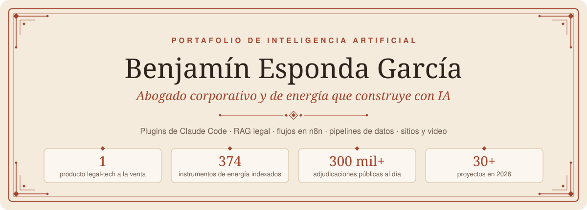
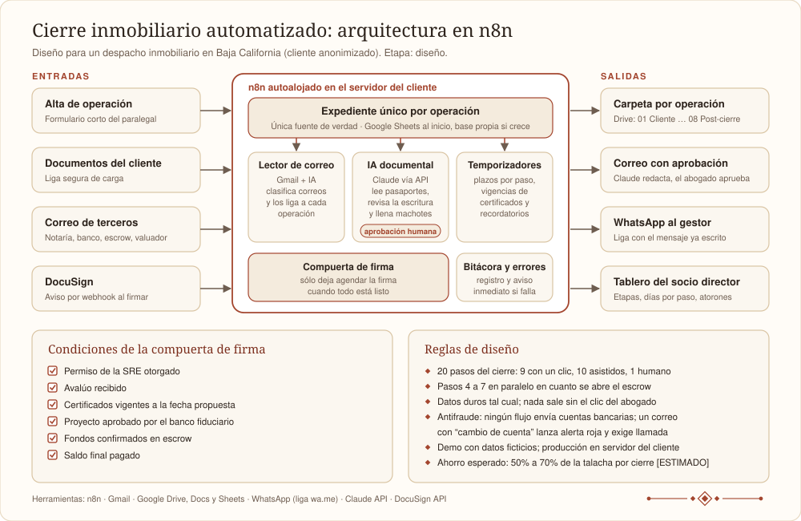

<p align="center"></p>

**Abogado corporativo mexicano (energía, hidrocarburos y minería, unos 8 años de práctica) que construye con inteligencia artificial.** Escribo el análisis legal y armo los sistemas alrededor de él y más allá: plugins y agentes en Claude Code, búsqueda sobre texto legal, flujos en n8n, pipelines de datos en Python, sitios web, video y agentes de IA para marketing.

**Un abogado que construye.** Derecho, negocios y tecnología aplicada: escribo el análisis legal en energía, corporativo y regulatorio, y construyo mis propias herramientas para hacerlo mejor.

Ciudad de México · beg.empleos@gmail.com · [pivotek.mx](https://pivotek.mx) · [LinkedIn](https://www.linkedin.com/in/benjamin-esponda-garc%C3%ADa-a743051b2) · [GitHub](https://github.com/BEG-lag) · Español (nativo), inglés (profesional) · [English version](README.md) · PDF en [`pdf/`](pdf/)

> **Uso la IA todos los días.** Este portafolio es una muestra, no una lista completa: hay proyectos confidenciales y otros que todavía no salen. El trabajo para clientes está anonimizado: se quitaron nombres, cifras y datos que los identifiquen. Nada en este repositorio constituye opinión legal.

<p align="center"></p>

## Contenido

1. [En breve](#1-en-breve)
2. [Código abierto](#2-código-abierto)
3. [Mapa de habilidades de IA](#3-mapa-de-habilidades-de-ia)
4. [Destacado: Con Criterio, kit de IA para abogados mexicanos](#4-destacado-con-criterio-kit-de-ia-para-abogados-mexicanos)
5. [Destacado: motor de búsqueda sobre derecho energético mexicano (RAG)](#5-destacado-motor-de-búsqueda-sobre-derecho-energético-mexicano-rag)
6. [Destacado: inteligencia de compras públicas para petróleo y gas](#6-destacado-inteligencia-de-compras-públicas-para-petróleo-y-gas)
7. [Destacado: automatización del cierre inmobiliario en n8n](#7-destacado-automatización-del-cierre-inmobiliario-en-n8n)
8. [Resumen diario del DOF para el sector energético (n8n)](#8-resumen-diario-del-dof-para-el-sector-energético-n8n)
9. [Trabajo legal y regulatorio hecho con IA](#9-trabajo-legal-y-regulatorio-hecho-con-ia)
10. [Sitios web, video y marketing digital con IA](#10-sitios-web-video-y-marketing-digital-con-ia)
11. [Mis herramientas](#11-mis-herramientas)
12. [Estudios de viabilidad](#12-estudios-de-viabilidad)
13. [Cómo trabajo con IA](#13-cómo-trabajo-con-ia)
14. [Formación y comunidad](#14-formación-y-comunidad)

<p align="center"></p>

## 1. En breve

- **IA todos los días:** la uso a diario en trabajo legal, productos, automatización y contenido, y me mantengo a la vanguardia de las herramientas y funciones nuevas. Lo que sigue es una muestra; hay proyectos confidenciales y otros que todavía no salen.
- **Más de 30 proyectos en 2026**, desde auditorías regulatorias internacionales hasta un producto legal-tech a la venta.
- **Impacto:** más de 40 asuntos legales hechos con IA y cerrados satisfactoriamente; 90.7% de artículos idénticos al texto oficial cuando un agente de IA aplicó 34 reformas reales del DOF ([reforma-al-dia](https://github.com/BEG-lag/reforma-al-dia)); y un producto en vivo, Con Criterio.
- **Un producto en vivo:** Con Criterio, guía con 7 plugins y 7 skills para abogados en México, en ediciones para Claude y ChatGPT, a la venta en [concriterio.mx](https://concriterio.mx) desde el 5 de noviembre de 2026.
- **Búsqueda sobre texto legal:** 374 instrumentos de derecho energético divididos en 11,112 fragmentos según la jerarquía de la norma mexicana, con búsqueda híbrida y un juego de pruebas de regresión.
- **Datos a escala:** un pipeline sobre más de 560,000 contratos de compras públicas para mostrar a proveedores de petróleo y gas dónde está el dinero.
- **Sitios, video y marketing:** cuatro sitios en vivo ([concriterio.mx](https://concriterio.mx), [pivotek.mx](https://pivotek.mx), [casalegado.mx](https://casalegado.mx) y [carocomunicando.com](https://carocomunicando.com)), un video de entrada a escenario para una conferencista, un pipeline automático de Reels y redes sociales operadas por agentes de IA (Grok Bot y Muse de Meta).
- **Código abierto:** 16 repositorios públicos en [GitHub](https://github.com/BEG-lag), entre ellos un agente que aplica al día las reformas del DOF a la ley, 36 leyes federales versionadas en git, un radar diario del sector energético y calculadoras de finiquito, renta y pensión con pruebas automáticas ([§2](#2-código-abierto)).
- **Herramientas conectadas:** Stripe, Gmail, Google Calendar y Drive, Vercel, Higgsfield, Apify, Canva y automatización del navegador, todo desde Claude Code.
- **Automatización con criterio:** todo flujo deja a una persona en el circuito cuando hay firmas, dinero o juicio legal de por medio.

<p align="center"></p>

## 2. Código abierto

**Estatus.** Los 12 con sitio en vivo están en operación; mcp-leyes, mcp-dof, segundo-cerebro y tema-clawds son productos publicados.

**Problema.** Buena parte del trabajo legal y administrativo diario depende de saber qué dice hoy la ley y de cálculos que nadie verifica; estas herramientas lo resuelven con el código a la vista.

16 repositorios públicos en [github.com/BEG-lag](https://github.com/BEG-lag), hechos con Claude Code y ordenados en los mismos cuatro bloques de mi perfil de GitHub. Quince se verifican en GitHub Actions con cada cambio (pruebas, tipos o datos) y doce tienen sitio en vivo. Cifras tomadas de cada repositorio (su README y sus pruebas en GitHub Actions) el 17 de noviembre de 2026.

### 2.1 Derecho, compilado

Herramientas abiertas que leen, aplican y auditan la ley mexicana.

- **[reforma-al-dia](https://github.com/BEG-lag/reforma-al-dia)** · Python · 84 pruebas. El día que el DOF publica una reforma, un agente de IA la aplica a leyes-mx y abre un pull request para que una persona lo revise antes de integrarlo; después se audita contra el texto oficial. Probado con 34 decretos reales publicados entre abril de 2019 y octubre de 2026, en 16 leyes: 90.7% de los artículos aplicados quedaron idénticos al texto oficial y 95.8% iguales salvo formato. [Sitio en vivo](https://beg-lag.github.io/reforma-al-dia/).
- **[leyes-mx](https://github.com/BEG-lag/leyes-mx)** · Python. 36 leyes federales en Markdown dentro de git, con 375 versiones históricas recuperadas de copias archivadas de los archivos de la Cámara de Diputados. Cada reforma es un commit con la fecha de su publicación en el DOF, así que cada ley tiene historial, `blame` y `diff`. 13,370 artículos con la numeración validada. [Sitio en vivo](https://beg-lag.github.io/leyes-mx/).
- **[mcp-leyes](https://github.com/BEG-lag/mcp-leyes)** · Python · 117 pruebas. Servidor MCP con la ley federal mexicana en cualquier fecha: el texto exacto de cada artículo, su historia de reformas, diferencias palabra por palabra y búsqueda, sobre el historial de leyes-mx. No es oficial ni asesoría legal.
- **[mcp-dof](https://github.com/BEG-lag/mcp-dof)** · Python · 87 pruebas · versión 1.0.0. Servidor MCP para que Claude consulte el Diario Oficial de la Federación: la edición de cualquier día, el texto íntegro de cada nota, búsqueda por título y el tipo de cambio FIX, las UDIS y la TIIE, desde la API oficial del SIDOF. También se publica como imagen de Docker.

### 2.2 Datos abiertos

Registros públicos convertidos en datos vivos, APIs e historias visuales.

- **[radar-energia](https://github.com/BEG-lag/radar-energia)** · Python · 53 pruebas. Radar diario del sector energético en México: el DOF por subsector, CNE, SENER, ASEA y CENACE, más el FIX y los precios eléctricos y de combustibles, cada dato con su fuente oficial y con un feed por subsector. Lo firmo como PIVOTEK. [Sitio en vivo](https://beg-lag.github.io/radar-energia/).
- **[constitucion-viva](https://github.com/BEG-lag/constitucion-viva)** · TypeScript. La Constitución de 1917, viva: 285 decretos de reforma y 857 reformas a artículos, con máquina del tiempo, el crecimiento del texto, los cambios palabra por palabra desde 2006 y la red de citas de 36 leyes federales. [Sitio en vivo](https://beg-lag.github.io/constitucion-viva/).
- **[indicadores-mx](https://github.com/BEG-lag/indicadores-mx)** · Python · 102 pruebas. 37,372 valores oficiales en 17 series (FIX desde 1991, UDIS, TIIE, INPC, salario mínimo y UMA), cada uno ligado a su nota del DOF, como API estática gratuita en JSON y CSV. Datos en dominio público (CC0). [Sitio en vivo](https://beg-lag.github.io/indicadores-mx/).
- **[dof-diario](https://github.com/BEG-lag/dof-diario)** · Python. Archivo del sumario del DOF desde enero de 2025: 484 días y 43,994 notas. Se actualiza solo dos veces al día con GitHub Actions y tiene un buscador con filtros. Datos en dominio público (CC0). [Sitio en vivo](https://beg-lag.github.io/dof-diario/).

### 2.3 Para el día a día

Pequeñas, privadas y útiles todos los días.

- **[hoy-circulo](https://github.com/BEG-lag/hoy-circulo)** · TypeScript · 101 pruebas. Hoy No Circula, verificación y contingencias ambientales de la CAMe en la Ciudad de México y el Estado de México; revisa los comunicados cada 30 minutos. App instalable que funciona sin conexión y exporta al calendario (.ics). No es oficial; cada regla cita su fuente. [Sitio en vivo](https://beg-lag.github.io/hoy-circulo/).
- **[aumento-renta](https://github.com/BEG-lag/aumento-renta)** · TypeScript · 91 pruebas · versión 1.0.0. Calcula cuánto puede subir una renta: la actualiza entre dos fechas con el INPC del INEGI o con UDIS, paso por paso y con la liga a la nota del DOF de cada valor. Para vivienda en la Ciudad de México revisa el tope del art. 2448 D del Código Civil para el Distrito Federal con las dos lecturas posibles de "la inflación del año anterior", y redacta el mensaje para el arrendador o el inquilino. App instalable que funciona sin conexión, sin cookies ni analítica; los datos oficiales (INPC desde 2003 y UDIS desde 1995) se actualizan solos desde el DOF. Es una herramienta de cálculo, no asesoría legal; liga a [Con Criterio](https://concriterio.mx). [Sitio en vivo](https://beg-lag.github.io/aumento-renta/).
- **[pension-imss](https://github.com/BEG-lag/pension-imss)** · TypeScript · 92 pruebas. Estima la pensión de vejez y cesantía del IMSS por Ley 73 y Ley 97 (con la reforma de 2020), con el artículo de cada paso y los criterios de la SCJN; donde los criterios difieren (UMA o salario mínimo, tope de 10 o 25 veces) deja elegir. Es una estimación informativa, no asesoría. [Sitio en vivo](https://beg-lag.github.io/pension-imss/).
- **[finiquito-mx](https://github.com/BEG-lag/finiquito-mx)** · TypeScript · 123 pruebas. Calcula finiquito y liquidación conforme a la Ley Federal del Trabajo, renglón por renglón y con el artículo de cada concepto; librería y web. Es una herramienta de cálculo, no asesoría legal. [Sitio en vivo](https://beg-lag.github.io/finiquito-mx/).
- **[facturas-cfdi](https://github.com/BEG-lag/facturas-cfdi)** · TypeScript · 79 pruebas unitarias y 13 de navegador. Organiza facturas CFDI (XML o el ZIP de descarga masiva del SAT) en el navegador, sin subir nada, y marca las que podrían ser deducciones personales. Es una herramienta de organización, no asesoría fiscal. [Sitio en vivo](https://beg-lag.github.io/facturas-cfdi/).
- **[mis-laboratorios](https://github.com/BEG-lag/mis-laboratorios)** · TypeScript · 127 pruebas unitarias y 16 de navegador. Organiza y grafica tus análisis clínicos en el navegador, sin subir nada: confirmas cada valor y ves cada indicador en el tiempo contra el rango del laboratorio. No interpreta, no diagnostica y no sustituye al médico; los ejemplos usan datos sintéticos. [Sitio en vivo](https://beg-lag.github.io/mis-laboratorios/).

### 2.4 Para Claude Code

Cómo trabajo, empaquetado para cualquiera.

- **[segundo-cerebro](https://github.com/BEG-lag/segundo-cerebro)**. Plantilla instalable de bóveda de Obsidian con las reglas para que Claude Code la lea antes de trabajar y la actualice después, con revisión semanal incluida. Es la versión pública, sin mis datos, del sistema de la [§11](#11-mis-herramientas).
- **[tema-clawds](https://github.com/BEG-lag/tema-clawds)**. Tema claro para la app de Claude Code con 64 Clawds, la mascota de Claude Code, jugando en 20 escenas SVG.

<p align="center"></p>

## 3. Mapa de habilidades de IA

| Habilidad | Qué he construido con ella |
|:-----|:-------------|
| Agentes de IA y flujos agénticos | Plugins, skills y subagentes de Claude Code para siete materias del derecho mexicano ([§4](#4-destacado-con-criterio-kit-de-ia-para-abogados-mexicanos)); un sistema multiagente de nueve roles con señales tipadas ([§11](#11-mis-herramientas)); redes sociales operadas por Grok Bot y Muse de Meta ([§10](#10-sitios-web-video-y-marketing-digital-con-ia)) |
| Búsqueda sobre documentos (RAG) | RAG legal con embeddings especializados en derecho, pgvector y ranking híbrido sobre 374 instrumentos de energía ([§5](#5-destacado-motor-de-búsqueda-sobre-derecho-energético-mexicano-rag)) |
| Ingeniería de datos | Un pipeline sobre más de 560,000 contratos de compras públicas con actualización semanal y auditorías ([§6](#6-destacado-inteligencia-de-compras-públicas-para-petróleo-y-gas)); modelos financieros en Python y Excel ([§12](#12-estudios-de-viabilidad)) |
| Automatización de procesos | Diseños en n8n para un cierre inmobiliario de 20 pasos y un resumen diario del DOF ([§7](#7-destacado-automatización-del-cierre-inmobiliario-en-n8n), [§8](#8-resumen-diario-del-dof-para-el-sector-energético-n8n)); tareas programadas para la revisión regulatoria mensual y la revisión semanal del segundo cerebro ([§4](#4-destacado-con-criterio-kit-de-ia-para-abogados-mexicanos), [§11](#11-mis-herramientas)) |
| IA para el trabajo legal | Auditorías regulatorias internacionales, revisiones de contratos y de cumplimiento, dictámenes y cartas, cada dato con fuente y fecha de corte ([§9](#9-trabajo-legal-y-regulatorio-hecho-con-ia)) |
| Construcción de productos | Con Criterio, del contenido al cobro, la entrega automática y las pruebas con compradores simulados ([§4](#4-destacado-con-criterio-kit-de-ia-para-abogados-mexicanos)) |
| Desarrollo web | concriterio.mx, pivotek.mx, casalegado.mx y carocomunicando.com ([§10](#10-sitios-web-video-y-marketing-digital-con-ia)) |
| Video y contenido con IA | Un video de entrada a escenario con locución de IA y motion graphics, y un pipeline automático de Reels con transcripción local y visión por computadora ([§10](#10-sitios-web-video-y-marketing-digital-con-ia)) |
| Marketing con IA | Más de una docena de skills de marketing y creatividad aplicados a campañas reales, auditorías SEO y textos de anuncios ([§10](#10-sitios-web-video-y-marketing-digital-con-ia)) |
| Integraciones (conectores MCP) | Stripe, Gmail, Google Calendar y Drive, Vercel, Higgsfield, Apify, Canva y más de 10,000 acciones de navegador ([§11](#11-mis-herramientas)), además de servidores MCP propios para el DOF y para la ley federal ([§2](#2-código-abierto)) |
| Criterio y calidad | Compuertas de aprobación humana, reglas antifraude, incertidumbre etiquetada, pruebas golden y construcción reproducible ([§13](#13-cómo-trabajo-con-ia)) |
| Aprendizaje continuo y comunidad | Licenciatura en Derecho (Ibero), Maestría en Derecho de la Empresa (Anáhuac) y MBA (EAE Madrid); uso diario de la IA y de las herramientas nuevas en cuanto salen; cursos gratuitos de Anthropic y Harvey; certificaciones en Platzi; cursos en vivo y pregrabados de tech influencers y escuelas digitales; pláticas y workshops de Claude en México ([§14](#14-formación-y-comunidad)) |

<p align="center"></p>

## 4. Destacado: Con Criterio, kit de IA para abogados mexicanos

**Estatus.** Producto publicado.

**Qué es.** Un kit práctico de IA para abogados en México: una guía (116 páginas en la edición Claude y 134 en la edición ChatGPT), 7 plugins por materia y 7 skills de redacción. A la venta en [concriterio.mx](https://concriterio.mx) desde el 5 de noviembre de 2026. Desde el 11 de noviembre también ofrece una guía de IA para principiantes, para el público general.

**Problema.** Los abogados en México quieren usar IA, pero no pueden confiar en respuestas sin fuente: la ley cambia y una cita inventada es un riesgo profesional.

**7 plugins por materia:** protección de datos (LFPDPPP), corporativo (LGSM), marcas (LFPPI), derecho de autor (LFDA), contratos mercantiles (Código de Comercio y LGTOC), energía (leyes de 2025) y notariado CDMX (Ley del Notariado y Ley Registral).

**Skills de redacción:** arrendamiento en CDMX, NDA bilateral, comisión mercantil, servicios profesionales, carta de intención, carta poder simple y calculadora de finiquito.

**Cómo se hizo.**

- Cada plugin es un conjunto de skills de Claude Code apoyado en un corpus curado de leyes y criterios judiciales verificados, con un formato único de cita, etiquetas de dato y un bloque de validación que corre antes de entregar cualquier respuesta.
- La guía de la edición Claude trae 115 afirmaciones verificadas y 46 capturas. La edición ChatGPT se adaptó con pasos de instalación para Windows.
- Un monitor en Python lee el DOF con el servicio de datos abiertos del gobierno y marca lo que toca a las leyes que cubre el producto. Una tarea programada corre una revisión regulatoria el día 1 de cada mes.
- Venta y entrega: página de venta, ligas de pago y webhook de Stripe, y un Worker de Cloudflare que entrega los archivos y opera el boletín (101 pruebas automáticas sin fallas).
- Su propia capa legal: términos y condiciones, aviso de privacidad y licencia de uso.
- Pruebas como comprador: una ronda simulada con 20 compradores dio 118 hallazgos distintos y cero bloqueantes; 114 de los 115 hallazgos abiertos se cerraron el mismo día.
- Marketing: contenido producido con Claude Code y publicado por agentes de IA ([§10](#10-sitios-web-video-y-marketing-digital-con-ia)), auditoría SEO, dos campañas de Google Ads preparadas y el Pixel de Meta conectado al flujo de pago.

<p align="center"></p>

## 5. Destacado: motor de búsqueda sobre derecho energético mexicano (RAG)

**Estatus.** Prototipo.

**Problema.** Las reglas de energía en México están dispersas entre el DOF y los sitios de ocho autoridades, y la reforma de 2025 sustituyó buena parte del marco. Encontrar el instrumento que de verdad aplica, y saber si sigue aplicando, toma horas.

**Qué construí.** Un pipeline que recopila, estructura e indexa la legislación energética mexicana para consultarla en lenguaje natural.

| Etapa | Cómo funciona |
|:---|:------------|
| Recopilación | Scrapers asíncronos sobre el DOF y los sitios de los reguladores, con pausas entre solicitudes |
| Extracción | Texto de los PDF con respaldo de OCR para documentos escaneados |
| Segmentación | Divide el texto según la jerarquía de la norma mexicana (título, capítulo, artículo) y no por tamaño fijo |
| Almacenamiento | PostgreSQL con pgvector: documentos y fragmentos, marca de vigencia y una nota de vigencia para normas formalmente vigentes pero suspendidas en la práctica |
| Embeddings | Voyage AI `voyage-law-2`, hecho para texto legal |
| Búsqueda | Ranking híbrido (similitud vectorial y palabras clave, combinadas con reciprocal rank fusion), sinónimos, detección de leyes y ponderaciones |
| Respuestas | Claude contesta preguntas en lenguaje natural sobre los fragmentos recuperados |
| Calidad | Juego de pruebas "golden" como barrera de regresión (9 de 9) y auditorías de la base por duplicados, vigencia y fechas de publicación |

**Escala (abril de 2026).** 374 documentos y 11,112 fragmentos, todos con embedding: 352 vigentes y 22 abrogados, de la CRE, la SENER, el CENACE, la CNH, el CENAGAS, la CNE, la ASEA y el Congreso. Sin LangChain ni LlamaIndex: Python y SQL directos.

<p align="center"></p>

## 6. Destacado: inteligencia de compras públicas para petróleo y gas

**Estatus.** Prototipo.

**Problema.** Los proveedores del sector de petróleo y gas en México licitan a ciegas: no saben quién compra lo que venden, a qué precio ni cuándo.

**Qué construí.** SupplySense, una herramienta de inteligencia de precios con datos de compras públicas.

- Carga de más de 560,000 contratos de CompraNet (2023 a 2025) en 26 categorías, más 150,000 contratos recientes de ComprasMX obtenidos con Playwright.
- Descarga semanal automática con eliminación de duplicados; datos enriquecidos con geografía y orden de gobierno; ligas por subsidiaria de PEMEX.
- Tablero con indicadores, listas de seguimiento, filtros por giro, búsqueda global y exportación a CSV y PDF; multi-cliente básico.
- Auditorías de datos que detectaron y corrigieron categorías mal clasificadas y valores atípicos, y un análisis del tamaño de mercado (TAM).

<p align="center"></p>

## 7. Destacado: automatización del cierre inmobiliario en n8n



**Problema.** Un despacho inmobiliario en Baja California cierra compraventas de extranjeros a través de fideicomisos bancarios. Cada cierre tiene 20 pasos y depende de la notaría, el banco fiduciario, el valuador, el escrow y el Registro Público. La mayor parte del tiempo de los abogados se va en perseguir documentos y contestar "¿cómo va mi cierre?".

**Diseño.**

- Un expediente único por operación alimenta todos los correos, documentos y avisos.
- 11 de los 20 pasos pueden correr casi solos, 7 quedan asistidos y 2 siguen siendo humanos: la revisión jurídica del proyecto de escritura y la firma ante notario.
- Los pasos 4 a 7 (permiso de la SRE, proyecto de escritura, avalúo y certificados) arrancan en paralelo en cuanto se abre el escrow, lo que podría ahorrar de 7 a 10 días por cierre (estimado).
- La IA documental lee pasaportes y certificados y compara el proyecto de escritura con el expediente, siempre con aprobación humana.
- Una compuerta de firma impide agendar el cierre hasta que se cumplen seis condiciones, entre ellas que los certificados sigan vigentes a la fecha propuesta y no sólo a hoy.
- Antifraude: ningún flujo envía cuentas bancarias, y cualquier correo sobre cambio de instrucciones de pago lanza una alerta roja y exige llamada de verificación.
- Los datos del cliente nunca viven en mi infraestructura: la demo corre con datos ficticios y la producción va en el servidor propio del despacho.

| Pieza | Qué es | Herramienta |
|:----|:-----------|:------|
| Expediente único | Una fila por operación con compradores, unidad, banco, notaría, escrow, fechas de cada paso, vigencias y estatus | Google Sheets al inicio; base de datos propia si crece el volumen |
| Carpeta por operación | Estructura fija creada sola: de 01 Cliente a 08 Post-cierre | Google Drive |
| Correo saliente | Plantillas bilingües para cliente, notaría, banco, valuador, HOA y escrow, llenadas desde el expediente | Gmail |
| Lector de correo entrante | Clasifica los correos de terceros, los liga a la operación, guarda adjuntos y mueve el estatus | Gmail e IA |
| WhatsApp | Avisos, recordatorios y un bot que contesta "¿cómo va mi cierre?" desde el expediente | WhatsApp Business API |
| IA documental | Lee pasaportes y certificados, compara el proyecto de escritura, resume videollamadas y comentarios del banco | API de Claude, con aprobación humana |
| Temporizadores y compuertas | Plazos por paso, vigencia de certificados y compuerta de firma | n8n |
| Tablero del socio director | Operaciones por etapa, días en cada paso, quién está atorando, alertas | Google Sheets o Looker Studio |
| Bitácora y errores | Registro de cada ejecución y aviso inmediato si un flujo falla | n8n |

**Estatus.** Etapa de diseño (noviembre de 2026). Propuesta entregada; decisiones en un registro de decisiones; implementación planeada en 4 fases de 10 a 13 semanas (estimado), empezando con un piloto en un solo desarrollo. Ahorro esperado: de 50% a 70% de las horas de talacha por cierre (estimado), a medir en el diagnóstico.

<p align="center"></p>

## 8. Resumen diario del DOF para el sector energético (n8n)

**Estatus.** En operación.

**Problema.** Cada mañana revisaba el DOF a mano para ver si salió algo que afectara a mis clientes de energía: unos 30 minutos al día (estimado).

```text
Schedule (lun a vie, 8:30) → HTTP Request (índice del día) → HTML (título, dependencia, liga)
  → Filter (palabras y dependencias de energía) → Aggregate → LLM (una frase + prioridad) → Gmail
```

**Resultado.** Un correo diario con las publicaciones de energía ordenadas por prioridad, unas 100 horas al año de ahorro (estimado). El flujo me dice qué leer; leerlo sigue siendo mi trabajo. Se hizo como primera entrega de un curso de automatización con n8n, con el prompt documentado y un plan de manejo de errores.

<p align="center"></p>

## 9. Trabajo legal y regulatorio hecho con IA

Por confidencialidad no detallo cada asunto ni a sus clientes.

**Problema.** Entregar análisis regulatorios en menos tiempo sin perder rigor: cada dato con su fuente y su fecha de corte.

- **Qué tipo de asuntos.** Rutas de entrada a mercados extranjeros, mapas de obligaciones de contratos de energía, due diligence de permisos, revisiones de cumplimiento sanitario y publicitario, dictámenes de marca, cartas institucionales y notas técnicas. Para contratistas de energía, comercializadoras de combustibles, empresas de consumo, despachos y dependencias de gobierno, en México y en el extranjero.
- **Cómo uso la IA.** Trabajo con Claude y Claude Code sobre un corpus de fuentes oficiales descargadas y convertidas a texto plano para cotejo literal; cada dato lleva cita y fecha de corte. Extraigo los contratos de forma estructurada a un archivo de contexto (obligaciones, plazos, alertas), reutilizo marcos regulatorios entre expedientes y escribo las reglas de redacción como restricciones verificables. Cuando aplica, uso mis propios plugins con el texto vigente de la ley. Los entregables (Word, PDF y HTML) salen de scripts generadores, con semáforo por sección. Esto es sólo un ejemplo, no todo lo que hago con IA. El análisis y el criterio son míos.

<p align="center"></p>

## 10. Sitios web, video y marketing digital con IA

**Estatus.** Sitios, video y redes con agentes: en operación. Reels automáticos: experimental.

**Problema.** Lanzar y vender un producto sin agencia: sitio, cobro, contenido y anuncios, hechos en casa.

- **Sitios:** [concriterio.mx](https://concriterio.mx) (venta y entrega automática de Con Criterio), [pivotek.mx](https://pivotek.mx) (este portafolio), [casalegado.mx](https://casalegado.mx) (mi marca de documentales biográficos) y [carocomunicando.com](https://carocomunicando.com) (una capacitadora en oratoria).
- **Video:** una intro de entrada a escenario para la capacitadora, con motion graphics en Remotion y voz de IA, y videos de sus eventos.
- **Reels automáticos:** de un video crudo a un Reel terminado, con transcripción local en Whisper, apoyos visuales y edición en Python.
- **Redes con agentes:** en Con Criterio, Claude Code produce el contenido y lo publican dos agentes: Grok Bot en TikTok y Muse de Meta en Instagram y Facebook.
- **Marketing:** más de una docena de skills de marketing aplicadas a casos reales: textos, anuncios, campañas y auditorías SEO.

<p align="center"></p>

## 11. Mis herramientas

**Estatus.** Segundo cerebro y BeCa: en operación. Sistema multiagente y CRMs: experimental.

**Problema.** Que una práctica de una sola persona opere como un equipo: agenda, correo, cobros y seguimiento, conectados.

**Conectores.** Claude Code llega a mis herramientas mediante conectores (MCP): el navegador (más de 10,000 acciones), el uso de computadora (más de 900), Stripe (unas 800 llamadas), Gmail, Google Calendar y Drive, tareas programadas, Vercel, Apify, Wispr Flow, Higgsfield (más de 1,000 llamadas), Canva y los Artifacts de Claude. Las cifras salen de los registros de mis sesiones.

- **Segundo cerebro en Obsidian:** una nota por proyecto, persona y documento oficial; cada sesión deja su entrada en la bitácora y una tarea semanal lee mi agenda y mi correo. La plantilla es pública: [segundo-cerebro](https://github.com/BEG-lag/segundo-cerebro).
- **Sistema multiagente y CRMs:** nueve roles que leen un mismo expediente y se pasan señales tipadas, y CRMs internos sobre [auto-crm](https://github.com/Hainrixz/auto-crm).
- **BeCa:** mi gato convertido en acompañante de escritorio. Una app de macOS en Swift que escucha los hooks de Claude Code y me dice con su postura qué está haciendo Claude: saluda, teclea, revisa y salta al terminar. ¿Por qué BeCa? Para darle un sentido del humor a mi día a día con la IA mientras trabajo.


<p align="center"></p>

## 12. Estudios de viabilidad

**Estatus.** Propuesta entregada.

**Problema.** Decidir si un negocio vale la pena antes de invertir en él.

Proyectos propios y servicios de PIVOTEK, mi consultoría, cada uno con veredicto y semáforo por fase. Gracias a herramientas de inteligencia artificial y al uso de skills propios, hemos hecho muchos planes de negocio, todos con conclusiones validadas por mí.

<p align="center"></p>

## 13. Cómo trabajo con IA

1. **Primero la fuente.** Los textos oficiales se descargan al proyecto y cada dato lleva su fuente y fecha de corte.
2. **La incertidumbre se etiqueta.** Todo entregable marca [ESTIMADO], [SUPUESTO] y [BRECHA DE DATO].
3. **Lo importante lo aprueba una persona.** Firmas, dinero y juicio legal siempre pasan por alguien.
4. **Entregables reproducibles.** Primero Markdown y luego PDF con pandoc y Typst; scripts que regeneran los archivos finales. Este portafolio se construye igual ([`build/`](build/)).
5. **Las decisiones quedan registradas.** Registros de decisiones y semáforos VERDE, AMARILLO y ROJO.
6. **Se prueba como usuario.** Compradores simulados, juegos de pruebas golden, pruebas automáticas y verificación contra el sitio en vivo.
7. **La validación es explícita.** Los estudios dicen qué debe confirmarse con la autoridad competente y no constituyen opinión legal.

### Herramientas técnicas

- **IA:** Claude Code (skills, plugins, subagentes, conectores MCP, hooks, tareas programadas), API de Claude, embeddings de Voyage AI, ChatGPT y Codex, Higgsfield (imagen, video, voz y música), Grok Bot y Muse de Meta.
- **Datos:** Python, PostgreSQL con pgvector, Playwright, pdfplumber y OCR, Excel.
- **Automatización:** n8n, Docker, launchd, GitHub Actions y tareas programadas.
- **Video:** Remotion, ffmpeg, Whisper, Apple Vision (Swift).
- **Web:** Next.js, TypeScript, HTML y CSS estáticos, GSAP, Cloudflare Workers, Vercel, GitHub Pages, Stripe, Resend, Web3Forms.
- **Marketing y analítica:** GA4, Microsoft Clarity, Vercel Analytics, Google Ads, Pixel de Meta, Google Search Console.
- **Documentos:** Markdown, pandoc, Typst, Word con control de cambios.
- **Conocimiento:** Obsidian.

<p align="center"></p>

## 14. Formación y comunidad

### Formación académica

| Título | Institución | Años |
|:--------|:-------|:----|
| Maestría en Derecho de la Empresa (Derecho Corporativo) | Universidad Anáhuac | 2023 a 2025 |
| Master of Business Administration (MBA), Administración de Empresas | EAE Business School, Madrid, España | 2023 a 2024 |
| Licenciatura en Derecho | Universidad Iberoamericana, CDMX | 2015 a 2020 |

### Cursos y comunidad

Uso la IA todos los días y me mantengo a la vanguardia de las herramientas y funciones nuevas de IA: las pruebo en trabajo real en cuanto salen.

- **Cursos gratuitos en línea de Anthropic** (Anthropic Academy).
- **Cursos gratuitos en línea de Harvey** sobre IA para el trabajo legal.
- **Certificaciones en la plataforma Platzi.**
- **Cursos en vivo y pregrabados** de la comunidad de tech influencers como Juan Lombana y Enrique Rocha, así como de escuelas digitales como Coderhouse y OrangutanAI.
- **Pláticas y workshops de Claude en México**, como Claude for AI Engineering (Claude Community CDMX, octubre de 2026), Claude for Legal, Claude for Finance, Claude Community House, Claude for Revenue, Claude for Games, Claude en la Cámara de Diputados y Claude en el Senado de la República, entre otros. En Claude for AI Engineering resumí las cinco ponencias (uso de herramientas, MCP, ingeniería de contexto) y convertí las notas en un agente que responde como lo haría cada ponente.

<p align="center"></p>
