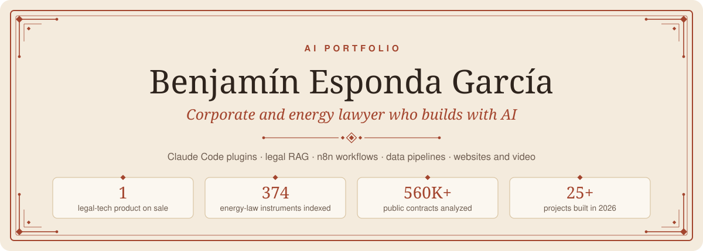
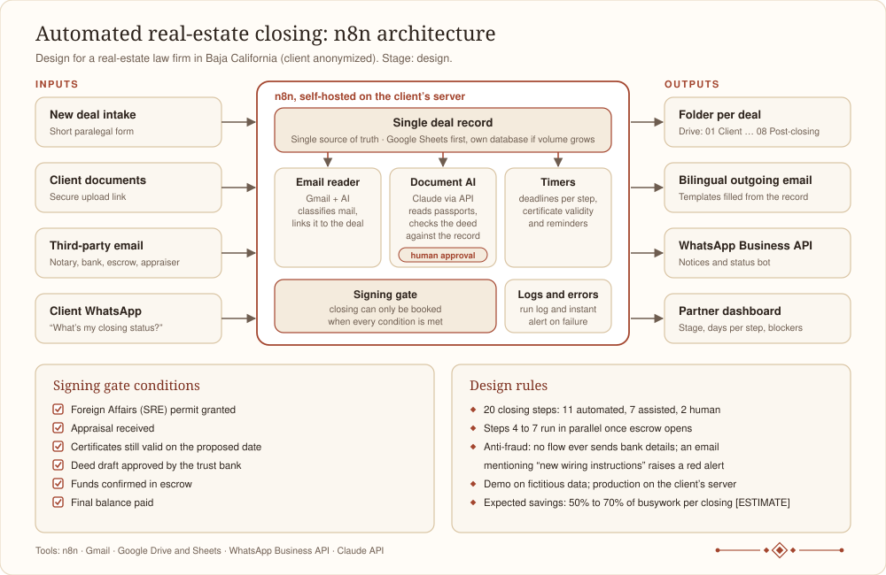

<p align="center"></p>

**Mexican corporate lawyer (energy, hydrocarbons and mining, about 8 years of practice) who builds with AI.** I write the legal analysis, and I build the systems around it and beyond it: Claude Code plugins and agents, retrieval over legal text, n8n workflows, Python data pipelines, websites, video and AI agents for marketing.

Mexico City · beg.empleos@gmail.com · [pivotek.mx](https://pivotek.mx) · [LinkedIn](https://www.linkedin.com/in/benjamin-esponda-garc%C3%ADa-a743051b2) · Spanish (native), English (professional) · [Versión en español](README.es.md) · PDF in [`pdf/`](pdf/)

> **I use AI every day.** This portfolio is a sample, not a complete list: some projects are confidential and others haven't been released yet. Client work is anonymized: names, figures and identifying details were removed. Nothing in this repository is legal advice.

<p align="center"></p>

## Contents

1. [At a glance](#1-at-a-glance)
2. [AI skills map](#2-ai-skills-map)
3. [Featured: Con Criterio, an AI toolkit for Mexican lawyers](#3-featured-con-criterio-an-ai-toolkit-for-mexican-lawyers)
4. [Featured: retrieval engine over Mexican energy law (RAG)](#4-featured-retrieval-engine-over-mexican-energy-law-rag)
5. [Featured: public procurement intelligence for oil and gas](#5-featured-public-procurement-intelligence-for-oil-and-gas)
6. [Featured: real-estate closing automation in n8n](#6-featured-real-estate-closing-automation-in-n8n)
7. [Daily regulatory digest from the Official Gazette (n8n)](#7-daily-regulatory-digest-from-the-official-gazette-n8n)
8. [Legal and regulatory work built with AI](#8-legal-and-regulatory-work-built-with-ai)
9. [Websites, video and digital marketing with AI](#9-websites-video-and-digital-marketing-with-ai)
10. [Connectors: how I automate, query and generate](#10-connectors-how-i-automate-query-and-generate)
11. [Tools and systems](#11-tools-and-systems)
12. [Feasibility studies](#12-feasibility-studies)
13. [Learning and community](#13-learning-and-community)
14. [How I work with AI](#14-how-i-work-with-ai)
15. [Stack](#15-stack)

<p align="center"></p>

## 1. At a glance

- **AI every day:** I use it daily for legal work, products, automation and content, and I stay at the forefront of new tools and features. What follows is a sample; some projects are confidential and others haven't been released yet.
- **More than 25 projects in 2026**, from cross-border regulatory audits to a legal-tech product that is on sale.
- **One product live:** Con Criterio, a guide plus 7 plugins and 7 skills for Mexican lawyers, sold in Claude and ChatGPT editions at [concriterio.mx](https://concriterio.mx) since November 5, 2026.
- **Retrieval over legal text:** 374 energy-law instruments split into 11,112 chunks along the hierarchy of Mexican statutes, with hybrid search and a regression test set.
- **Data at scale:** a pipeline over more than 560,000 public procurement contracts to show oil and gas suppliers where the money goes.
- **Websites, video and marketing:** four sites live ([concriterio.mx](https://concriterio.mx), [pivotek.mx](https://pivotek.mx), [casalegado.mx](https://casalegado.mx) and [carocomunicando.com](https://carocomunicando.com)), a stage-entrance video for a speaker, an automated Reels pipeline, and social media run by AI agents (Grok Bot and Meta's Muse).
- **Connected tools:** Stripe, Gmail, Google Calendar and Drive, Vercel, Higgsfield, Apify, Canva and browser automation, all driven from Claude Code.
- **Automation with judgment:** every workflow keeps a person in the loop where signatures, money or legal judgment are involved.

<p align="center"></p>

## 2. AI skills map

| Skill | What I have built with it |
|:-----|:-------------|
| AI agents and agentic workflows | Claude Code plugins, skills and subagents for seven areas of Mexican law ([§3](#3-featured-con-criterio-an-ai-toolkit-for-mexican-lawyers)); a nine-role multi-agent system with typed handoffs ([§11](#11-tools-and-systems)); social media run by Grok Bot and Meta's Muse ([§9.4](#94-social-media-run-by-ai-agents)) |
| Retrieval over documents (RAG) | Legal RAG with law-specific embeddings, pgvector and hybrid ranking over 374 energy-law instruments ([§4](#4-featured-retrieval-engine-over-mexican-energy-law-rag)) |
| Data engineering | A pipeline over more than 560,000 public procurement contracts with weekly updates and audits ([§5](#5-featured-public-procurement-intelligence-for-oil-and-gas)); financial models in Python and Excel ([§12](#12-feasibility-studies)) |
| Workflow automation | n8n designs for a 20-step real-estate closing and a daily regulatory digest ([§6](#6-featured-real-estate-closing-automation-in-n8n), [§7](#7-daily-regulatory-digest-from-the-official-gazette-n8n)); scheduled tasks for monthly regulatory reviews and a weekly second-brain review ([§3](#3-featured-con-criterio-an-ai-toolkit-for-mexican-lawyers), [§11](#11-tools-and-systems)) |
| AI for legal work | Cross-border regulatory audits, contract and compliance reviews, opinions and letters, every data point with source and cut-off date ([§8](#8-legal-and-regulatory-work-built-with-ai)) |
| Product building | Con Criterio, from content to payments, automated delivery and QA with simulated buyers ([§3](#3-featured-con-criterio-an-ai-toolkit-for-mexican-lawyers)) |
| Web development | concriterio.mx, pivotek.mx, casalegado.mx and carocomunicando.com ([§9.1](#91-websites)) |
| AI video and content | A stage-entrance video with AI voice-over and motion graphics, and an automated Reels pipeline with local transcription and computer vision ([§9.2](#92-speaker-intro-and-event-videos), [§9.3](#93-automated-reels-pipeline)) |
| AI marketing | More than a dozen marketing and creative skills applied to real campaigns, SEO audits and ad copy ([§9.5](#95-marketing-skills-and-how-i-applied-them)) |
| Integrations (MCP connectors) | Stripe, Gmail, Google Calendar and Drive, Vercel, Higgsfield, Apify, Canva and more than 10,000 browser actions ([§10](#10-connectors-how-i-automate-query-and-generate)) |
| Judgment and quality | Human approval gates, anti-fraud rules, labeled uncertainty, golden test sets and reproducible builds ([§14](#14-how-i-work-with-ai)) |
| Continuous learning and community | Law degree (Ibero), Master's in Business Law (Anáhuac) and MBA (EAE Madrid); daily use of AI and of new tools as soon as they launch; free courses from Anthropic and Harvey; live and pre-recorded courses from tech influencers and digital schools; Claude and Grok Bot talks and workshops; networking dinners with CTOs ([§13](#13-learning-and-community)) |

<p align="center"></p>

## 3. Featured: Con Criterio, an AI toolkit for Mexican lawyers

**What it is.** A practical AI toolkit for lawyers in Mexico: a guide (116 pages in the Claude edition, 134 in the ChatGPT edition), 7 plugins by practice area and 7 drafting skills. On sale at [concriterio.mx](https://concriterio.mx) since November 5, 2026. Since November 11 it also offers a beginners' guide to everyday AI for the general public.

| Plugin | What it covers |
|:----|:------------|
| Data protection | Federal data protection law: privacy notices, processor agreements, transfers, infringement risk, defense before the authority |
| Corporate | General Law of Commercial Companies: shareholder minutes, bylaws audits, powers of attorney, corporate due diligence, step-by-step restructurings |
| Trademarks | Industrial Property Law: registrability, oppositions, nullity and lapse, infringement, deadlines before the trademark office |
| Copyright | Federal Copyright Law: ownership opinions, transfer clauses, exceptions, notice and takedown, works made with AI |
| Commercial contracts | Commercial Code and negotiable instruments law: drafting and review, promissory notes, credit operations and trusts, interest and usury, collection routes |
| Energy | Mexico's 2025 energy laws: permit roadmaps, power and hydrocarbons projects, sanctions, a 2014 versus 2025 comparison |
| Notarial practice (Mexico City) | Notarial and registry law: deed requirements, wills and advance directives, probate before a notary |

**Drafting skills:** residential lease (Mexico City), mutual NDA, commercial agency, professional services, letter of intent, simple power of attorney and a severance calculator.

**How it was built.**

- Each plugin is a set of Claude Code skills grounded on a curated corpus of statutes and verified court criteria, with one citation format, data labels and a validation block that runs before any answer is delivered.
- The Claude edition guide carries 115 verified claims and 46 screenshots. The ChatGPT edition was ported with install steps for Windows.
- A Python monitor reads the Official Gazette (DOF) through the government's open-data web service and flags anything that touches the statutes the product covers. A scheduled task runs a regulatory review on the 1st of every month.
- Sales and delivery: sales page, Stripe payment links and webhook, and a Cloudflare Worker that delivers the files and runs the newsletter (101 automated tests passing).
- Its own legal layer: terms and conditions, privacy notice and license of use.
- QA like a buyer: a simulated round with 20 buyers produced 118 distinct findings and zero blockers; 114 of the 115 open findings were closed the same day.
- Marketing: content produced with Claude Code and published by AI agents ([§9.4](#94-social-media-run-by-ai-agents)), SEO audit, two Google Ads campaigns prepared and the Meta Pixel connected to the payment flow.

<p align="center"></p>

## 4. Featured: retrieval engine over Mexican energy law (RAG)

**Problem.** Mexico's energy rules are scattered across the Official Gazette and the websites of eight energy authorities, and the 2025 reform replaced much of the framework. Finding the instrument that actually applies, and knowing whether it still applies, takes hours.

**What I built.** A pipeline that collects, structures and indexes Mexican energy legislation so it can be queried in natural language.

| Stage | How it works |
|:---|:------------|
| Collection | Async scrapers over the Official Gazette and regulators' sites, with polite delays |
| Extraction | Text from PDFs with an OCR fallback for scanned documents |
| Chunking | Splits text along the hierarchy of Mexican legal instruments (title, chapter, article) instead of fixed sizes |
| Storage | PostgreSQL with pgvector: documents and chunks, validity flags and a validity note for rules that are formally in force but suspended in practice |
| Embeddings | Voyage AI `voyage-law-2`, built for legal text |
| Search | Hybrid ranking (vector similarity plus keyword, merged with reciprocal rank fusion), synonyms, statute detection and boosts |
| Answers | Claude answers natural-language questions over the retrieved chunks |
| Quality | A golden test set used as a regression guardrail (9 of 9 passing) and database audits for duplicates, validity and publication dates |

**Scale (April 2026).** 374 documents and 11,112 chunks, all embedded: 352 in force and 22 repealed, from the Energy Regulatory Commission, the Energy Ministry, the grid operator, the hydrocarbons and gas regulators, the safety agency and Congress. No LangChain or LlamaIndex: plain Python and SQL.

<p align="center"></p>

## 5. Featured: public procurement intelligence for oil and gas

**Problem.** Suppliers to the oil and gas sector in Mexico bid blind: they don't know who buys what they sell, at what price, or when.

**What I built.** SupplySense, a price-intelligence tool built on public procurement data.

- Loaded more than 560,000 contracts from CompraNet (2023 to 2025) across 26 categories, plus 150,000 recent contracts from ComprasMX collected with Playwright.
- Weekly automatic download with deduplication; data enrichment with geography and level of government; per-subsidiary links for the national oil company.
- Dashboard with KPIs, watchlists, "my line of business" filters, global search, and CSV and PDF export; basic multi-tenancy per client.
- Data audits that caught and fixed misclassified categories and outliers, and a market sizing (TAM) analysis.

<p align="center"></p>

## 6. Featured: real-estate closing automation in n8n



**Problem.** A real-estate law firm in Baja California closes property purchases by foreign buyers through Mexican bank trusts. Each closing has 20 steps and depends on a notary, a trust bank, an appraiser, an escrow agent and the public registry. Most of the lawyers' time goes to chasing documents and answering "what's the status of my closing?".

**Design.**

- One deal record feeds every email, document and notice.
- 11 of the 20 steps can run almost on their own, 7 are assisted, and 2 stay human: the legal review of the deed draft and the signing before the notary.
- Steps 4 to 7 (foreign-affairs permit, deed draft, appraisal and certificates) start in parallel the moment escrow opens, which could cut 7 to 10 days per closing [ESTIMATE].
- Document AI reads passports and certificates and compares the deed draft against the record, always with human approval.
- A signing gate blocks booking the closing until six conditions are met, including certificates that are still valid on the proposed date, not just today.
- Anti-fraud: no workflow ever sends bank details, and any incoming email about new wiring instructions raises a red alert and requires a phone call.
- Client data never lives on my infrastructure: the demo runs on fictitious data and production goes on the firm's own server.

| Component | What it is | Tool |
|:----|:-----------|:------|
| Single deal record | One row per deal with buyers, unit, bank, notary, escrow, dates per step, validity periods and status | Google Sheets first; own database if volume grows |
| Folder per deal | Fixed structure created automatically: 01 Client to 08 Post-closing | Google Drive |
| Outgoing email | Bilingual templates for client, notary, bank, appraiser, HOA and escrow, filled from the record | Gmail |
| Incoming email reader | Classifies third-party emails, links them to the deal, files attachments and moves the status | Gmail and AI |
| WhatsApp | Notices, reminders and a bot that answers "what's my status?" from the record | WhatsApp Business API |
| Document AI | Reads passports and certificates, compares the deed draft, summarizes calls and bank comments | Claude API, with human approval |
| Timers and gates | Deadlines per step, certificate validity and the signing gate | n8n |
| Partner dashboard | Deals by stage, days per step, who is blocking, alerts | Google Sheets or Looker Studio |
| Logs and errors | Record of every run and an instant alert if a flow fails | n8n |

**Status.** Design stage (November 2026). Proposal delivered; decisions kept in a decision register; rollout planned in 4 phases over 10 to 13 weeks [ESTIMATE], starting with a pilot on one development. Expected savings: 50% to 70% of busywork hours per closing [ESTIMATE], to be measured in the diagnosis.

<p align="center"></p>

## 7. Daily regulatory digest from the Official Gazette (n8n)

**Problem.** Every morning I reviewed the Official Gazette by hand for anything affecting my energy clients: about 30 minutes a day [ESTIMATE].

```text
Schedule (Mon to Fri, 8:30) → HTTP Request (today's index) → HTML (title, agency, link)
  → Filter (energy keywords and agencies) → Aggregate → LLM (one line + priority) → Gmail
```

**Result.** One email a day with the energy publications sorted by priority, about 100 hours a year saved [ESTIMATE]. The workflow tells me what to read; reading it is still my job. Built as the first deliverable of an n8n automation course, with a documented prompt and an error-handling plan.

<p align="center"></p>

## 8. Legal and regulatory work built with AI

For confidentiality, I don't detail each matter or its clients.

- **What kind of matters.** Market entry routes, obligation maps for energy contracts, permit due diligence, health and advertising compliance reviews, trademark opinions, institutional letters and technical notes. For energy contractors, fuel traders, consumer goods companies, law firms and government agencies, in Mexico and abroad.
- **How I use AI.** I work with Claude and Claude Code on a corpus of official sources, downloaded and converted to plain text for verbatim cross-checking; every data point carries a citation and a cut-off date. I extract contracts in structured form into a context file (obligations, deadlines, alerts), reuse regulatory frameworks across files and write drafting rules as verifiable constraints. Where it applies, I use my own plugins with the current text of the law. Deliverables (Word, PDF and HTML) come out of generator scripts, with a traffic light per section. This is only an example, not everything I do with AI. The analysis and the judgment are mine.

<p align="center"></p>

## 9. Websites, video and digital marketing with AI

### 9.1 Websites

| Site | What it is | How it was built |
|:----|:------|:---------|
| [concriterio.mx](https://concriterio.mx) | Sales site of Con Criterio: a page for lawyers and [/para-todos](https://concriterio.mx/para-todos/) for beginners, with a build-your-purchase panel | Pages and legal texts (terms, privacy notice, license) generated with Python scripts; Stripe payment links and a Cloudflare Worker for checkout and delivery; Cloudflare Pages, DNS and Web Analytics; Meta Pixel and two Google Ads search campaigns set up |
| [pivotek.mx](https://pivotek.mx) | Home of this portfolio. It replaced the previous Next.js site of PIVOTEK, my personal brand and consultancy, which I also built (TypeScript, contact form with Resend, technical SEO) | Designed and built by Fable 5.2 (Claude) from the plain text of this README, under my direction: ink and traffic-light palette, 20 sections with their own scroll animations (word-by-word reveals, stacking cards, a 20-step closing that flips block by block, BeCa's states), GSAP, ScrollTrigger and Lenis self-hosted under a strict content security policy; deployed on Vercel |
| [casalegado.mx](https://casalegado.mx) | My biographical documentary brand: five-page site plus brandbook, sales dossier and sales presentation | Static HTML and CSS under a strict brand system (two typefaces, a warm palette and voice rules), illustrative images generated with Higgsfield, privacy notice, sitemap, Google Business Profile copy, Google Ads tags and a content security policy, deployed on Vercel |
| [carocomunicando.com](https://carocomunicando.com) | Site of a public-speaking and communication trainer: home with an animated cover, her method, her TEDx talk, cases and brand pages | Static site with self-hosted GSAP, ScrollTrigger and Lenis; a downloadable PDF guide with optional email capture; GA4, Microsoft Clarity and Vercel Analytics declared in the privacy notice and cookie banner; 301 redirects, security headers and a content security policy; SEO audit and blog articles |

### 9.2 Speaker intro and event videos

- **Stage-entrance intro (102 seconds)** for the trainer, projected before she walks on stage. Five versions; the current one combines motion graphics built in Remotion, an AI voice-over (ElevenLabs v4 through Higgsfield), original music and sound effects, and her photos. It comes with a waiting loop for the screen and three short Instagram Reels cut from the same material. Every version can be rebuilt from scripts (Python, Node and ffmpeg).
- **Event highlight (40 seconds)** of her role as host and moderator of a university entrepreneurship summit: 9:16 for Reels, TikTok and LinkedIn and 16:9 for YouTube, with original music timed to the moment the stage lights come on.
- **Book launch loop:** an animated screen for the presentation of her book, with quotes that rotate every 10 seconds and verified QR codes to her Instagram and website.

### 9.3 Automated Reels pipeline

Drop a raw video in Downloads and get a finished Reel:

1. **Transcription** word by word, locally, with Whisper.
2. **Style rules** learned from a reference creator: four Reels analyzed frame by frame, with cut-rate measurements (a hard cut to B-roll every 5 to 9 seconds, title pills, a closing question).
3. **Supporting visuals:** licensed real photos from Wikimedia Commons and Openverse, with credits, or B-roll generated with Higgsfield.
4. **Subject cut-out and face tracking** with Apple's Vision framework (Swift).
5. **Automatic edit** in Python: format, subtitles, pills, cards, photo credits and the speaker's frame; a history file avoids repeating formats.

Six Reels ready to publish in November 2026, a monthly set of scripts, and a technical guide to publish through the Instagram Graph API with n8n.

### 9.4 Social media run by AI agents

For Con Criterio, the work is split between Claude Code and two external agents:

| Who | What it does |
|:-----|:-------------|
| Claude Code | Produces the content and the publishing calendar, writes the prompts for the agents and the checklists to verify their work |
| Grok Bot (an agent that operates my Mac) | Publishes two TikTok Reels a day and handles Instagram prospecting and direct messages; if the Mac is asleep or asks for a code, it stops and warns |
| Muse (Meta's AI marketing agent) | Publishes three posts a day on Instagram and Facebook, runs the campaigns and continues the conversation when a prospect answers |

The labeling of AI-generated content was reviewed with Muse, and verification prompts audit what each agent actually did.

### 9.5 Marketing skills and how I applied them

| Skill | What it does | Where I applied it |
|:----|:-------|:-------|
| humanizalo-es | Removes the tells of AI writing in Spanish and keeps a human or brand voice | Copy for carocomunicando.com and its Reels, Con Criterio pages and posts, course deliverables |
| social-content | Social posts, calendars and short-video scripts | Reels scripts and calendar for the trainer; Con Criterio's social strategy |
| content-strategy | What to publish and why: pillars, topics and calendar | Con Criterio's content strategy for Instagram, Facebook and TikTok |
| copywriting | Page and offer copy | Business plans and the trainer's site |
| marketing-psychology | Behavioral principles such as anchoring, social proof and framing | The trainer's offer and pages; business plans |
| pricing-strategy | Packaging and price | Pricing in business plans and the trainer's proposals |
| ad-creative | Ad headlines and copy at scale, within each platform's limits | Ad variations for the trainer's campaigns |
| campaign-plan | Campaign brief: goals, audience, channels, calendar and metrics | Traffic and contacts plan for the trainer (November 2026) |
| seo-audit | SEO audit with quick wins and strategic actions | Audits of carocomunicando.com and concriterio.mx |
| Higgsfield skills (generate, art director, brand kit, video explainer) | Images, video, voice-over and music | Speaker intro, B-roll and book loop; Casa Legado images; Con Criterio explainer pieces |
| frontend-design and emil-design-eng | Interface design and motion polish | Con Criterio's sales page |
| apify-lead-gen | Lead lists from public sources | Prospect base for a website service in Los Cabos |
| abogado-el-diablo | Stress-tests a plan before acting | Con Criterio's launch strategy |

<p align="center"></p>

## 10. Connectors: how I automate, query and generate

Claude Code reaches my tools through connectors (MCP). Counts come from my own session logs.

| Use | Connector | What I do with it |
|:--|:-------|:---------|
| Automate | Claude in Chrome and the built-in browser (more than 10,000 actions) | Operate web dashboards, test my sites end to end, upload files and check what is live |
| Automate | Computer use (more than 900 actions) | Drive native Mac apps when there is no API |
| Automate | Stripe (about 800 calls) | Products, prices, payment links and webhooks for Con Criterio |
| Automate | Gmail, Google Calendar and Google Drive | Weekly review of calendar and inbox, drafts and follow-ups, file search |
| Automate | Scheduled tasks | Weekly second-brain review, monthly regulatory review, follow-ups on campaign setup |
| Automate | Vercel | Projects, domains and web analytics of my sites |
| Query | Apify | Web scraping, lead lists and web browsing for research |
| Query | Wispr Flow | Search across my meeting notes |
| Generate | Higgsfield (more than 1,000 calls) | Images, video, voice-over and music for sites, Reels and the speaker intro |
| Generate | Canva | Designs from brand kits |
| Generate | Claude artifacts | Shareable pages |

Plus two external agents (Grok Bot and Muse, [§9.4](#94-social-media-run-by-ai-agents)) and local command-line tools: Obsidian, GitHub, Whisper and ffmpeg.

<p align="center"></p>

## 11. Tools and systems

- **Second brain on Obsidian and Claude Code.** One note per project, person and official document; every working session leaves a log entry; a scheduled task reads my calendar and email every Sunday (read-only) and updates the vault; hourly backup with launchd. This portfolio was assembled from it.
- **Personal multi-agent system.** Nine specialist roles read one shared record, pass typed signals instead of prose and follow a declared precedence rule when they disagree. Personal use; no data shown.
- **My own internal CRMs.** Built on the architecture of [auto-crm](https://github.com/Hainrixz/auto-crm), an open-source local CRM with Next.js, SQLite and Claude Code that adapts to each business.

### BeCa, my desktop companion


BeCa is my cat turned into a sticker-style companion that lives in a small floating window on my Mac. It listens to Claude Code's lifecycle hooks, so I can tell at a glance what Claude is doing without looking at the terminal. Click it once and it waves; click again and it plays with Clawd, Claude Code's mascot, for about four seconds. It runs locally, uses no network and stores no content. Why BeCa? To bring a sense of humor to my day-to-day work with AI.

| What Claude Code is doing | Hook | What BeCa does |
|:-------|:------|:--------|
| Starting a session | SessionStart | Waves twice, then rests |
| Working on a request or running a tool | UserPromptSubmit, PreToolUse, PostToolUse | Types in the air |
| Editing or writing a file | PostToolUse of Edit or Write | Inspects the work, paw on chin |
| Finished its turn | Stop | Jumps four times and waves |
| Waiting for my permission or answer | PermissionRequest, Notification | Asks with its paws together |
| Hit an API error | StopFailure | Deflates once |
| Session closed | SessionEnd | Rests |

**How it was built:** a native macOS app in Swift, made with Claude Code; the art was generated with Higgsfield from three photos of my cat and cut into animation strips with Python scripts; the sounds were extracted from AI-generated video clips; the hooks are global, so BeCa works in every project.

<p align="center"></p>

## 12. Feasibility studies

Own ventures and services of PIVOTEK, my consultancy, each with a go or no-go verdict and traffic lights by phase:

- Fuel trucking from La Paz to Los Cabos: conditional go.
- Gas station under a national fuel brand franchise in Los Cabos: conditional go.
- Processed-glass plant for real estate in Baja California Sur: pre-feasibility with a financial model in Python, 782 business-registry records and a matrix of 24 industrial permits; conditional go in two phases.
- Biographical documentaries (Casa Legado): viability, business model, financial model, brand and website executed.
- Ice factory, organizational consulting, marine tours and a Los Cabos business plan.
- Monetization service for small and mid-size mines: sales deck and master prompt.
- Ten-year real-estate appreciation model in Excel with live formulas.

<p align="center"></p>

## 13. Learning and community

### Academic background

| Degree | School | Years |
|:--------|:-------|:----|
| Master's in Business Law (Maestría en Derecho de la Empresa), corporate law | Universidad Anáhuac | 2023 to 2025 |
| Master of Business Administration (MBA), business administration | EAE Business School, Madrid, Spain | 2023 to 2024 |
| Law degree (Licenciatura en Derecho) | Universidad Iberoamericana, Mexico City | 2015 to 2020 |

### Courses and community

I use AI every day and I stay at the forefront of new AI tools and features: I test them on real work as soon as they come out.

- **Anthropic's free online courses** (Anthropic Academy).
- **Harvey's free online courses** on AI for legal work.
- **Live and pre-recorded courses** from the community of tech influencers such as Juan Lombana and Enrique Rocha, and from digital schools such as Coderhouse and OrangutanAI.
- **Claude talks and workshops in Mexico**, such as Claude for AI Engineering (Claude Community CDMX, October 2026), Claude for Legal, Claude for Finance, Claude Community House, Claude for Revenue, Claude for Games, Claude at the Chamber of Deputies and Claude at the Mexican Senate, among others. At Claude for AI Engineering I summarized the five talks (tool use, MCP, context engineering) and turned the notes into an agent that answers as each speaker would.
- **Grok Bot talks and workshops.**
- **Networking dinners with CTOs** of large and mid-size companies.
- **n8n automation course** (in progress): the daily regulatory digest in [§7](#7-daily-regulatory-digest-from-the-official-gazette-n8n) was the first deliverable.

<p align="center"></p>

## 14. How I work with AI

1. **Sources first.** Official texts are downloaded into the project, and each data point carries its source and cut-off date.
2. **Uncertainty is labeled.** Every deliverable marks [ESTIMATE], [ASSUMPTION] and [DATA GAP].
3. **People approve what matters.** Signatures, money and legal judgment always go through a person.
4. **Reproducible deliverables.** Markdown first, then PDF with pandoc and Typst; generator scripts rebuild the final files. This portfolio is built the same way ([`build/`](build/)).
5. **Decisions are logged.** Decision registers and GREEN, YELLOW and RED status lights.
6. **Test like a user.** Simulated buyers, golden test sets, automated tests and checks against the live site.
7. **Validation is explicit.** Studies state what must be confirmed with the competent authority and are not legal advice.

<p align="center"></p>

## 15. Stack

- **AI:** Claude Code (skills, plugins, subagents, MCP connectors, hooks, scheduled tasks), Claude API, Voyage AI embeddings, ChatGPT and Codex, Higgsfield (image, video, voice and music), Grok Bot and Meta's Muse.
- **Data:** Python, PostgreSQL with pgvector, Playwright, pdfplumber and OCR, Excel.
- **Automation:** n8n, Docker, launchd and scheduled tasks.
- **Video:** Remotion, ffmpeg, Whisper, Apple Vision (Swift).
- **Web:** Next.js, TypeScript, static HTML and CSS, GSAP, Cloudflare Workers, Vercel, Stripe, Resend, Web3Forms.
- **Marketing and analytics:** GA4, Microsoft Clarity, Vercel Analytics, Google Ads, Meta Pixel, Google Search Console.
- **Documents:** Markdown, pandoc, Typst, Word with tracked changes.
- **Knowledge:** Obsidian.

<p align="center"></p>
