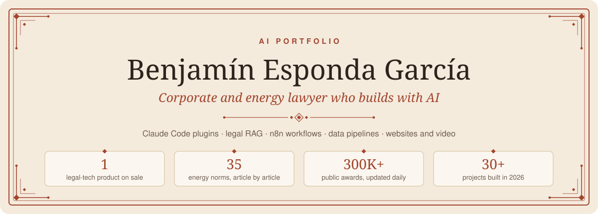
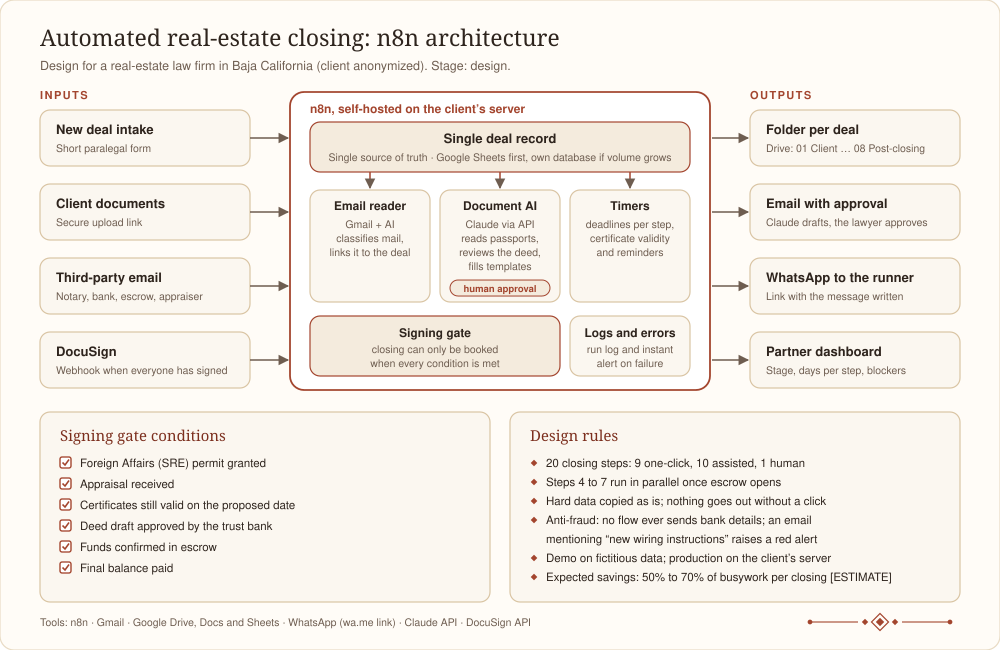

<p align="center"></p>

**Mexican corporate lawyer (energy, hydrocarbons and mining, about 8 years of practice) who builds with AI.** I write the legal analysis, and I build the systems around it and beyond it: Claude Code plugins and agents, retrieval over legal text, n8n workflows, Python data pipelines, websites, video and AI agents for marketing.

**A lawyer who builds.** Law, business and applied technology: I write the legal analysis in energy, corporate and regulatory work, and I build my own tools to do it better.

Mexico City · beg.empleos@gmail.com · [pivotek.mx](https://pivotek.mx) · [LinkedIn](https://www.linkedin.com/in/benjamin-esponda-garc%C3%ADa-a743051b2) · [GitHub](https://github.com/BEG-lag) · Spanish (native), English (professional) · [Versión en español](README.es.md) · PDF in [`pdf/`](pdf/)

> **I use AI every day.** This portfolio is a sample, not a complete list: some projects are confidential and others haven't been released yet. Client work is anonymized: names, figures and identifying details were removed. Nothing in this repository is legal advice.

<p align="center"></p>

## Contents

1. [At a glance](#1-at-a-glance)
2. [Open source](#2-open-source)
3. [AI skills map](#3-ai-skills-map)
4. [Featured: Con Criterio, an AI toolkit for Mexican lawyers](#4-featured-con-criterio-an-ai-toolkit-for-mexican-lawyers)
5. [Featured: retrieval engine over Mexican energy law (RAG)](#5-featured-retrieval-engine-over-mexican-energy-law-rag)
6. [Featured: public procurement intelligence for oil and gas](#6-featured-public-procurement-intelligence-for-oil-and-gas)
7. [Featured: real-estate closing automation in n8n](#7-featured-real-estate-closing-automation-in-n8n)
8. [Daily regulatory digest from the Official Gazette (n8n)](#8-daily-regulatory-digest-from-the-official-gazette-n8n)
9. [Legal and regulatory work built with AI](#9-legal-and-regulatory-work-built-with-ai)
10. [Websites, video and digital marketing with AI](#10-websites-video-and-digital-marketing-with-ai)
11. [My tools](#11-my-tools)
12. [Feasibility studies](#12-feasibility-studies)
13. [How I work with AI](#13-how-i-work-with-ai)
14. [Learning and community](#14-learning-and-community)

<p align="center"></p>

## 1. At a glance

- **AI every day:** I use it daily for legal work, products, automation and content, and I stay at the forefront of new tools and features. What follows is a sample; some projects are confidential and others haven't been released yet.
- **More than 30 projects in 2026**, from cross-border regulatory audits to a legal-tech product that is on sale.
- **Impact:** more than 40 legal matters done with AI and closed successfully; 90.7% of articles identical to the official text when an AI agent applied 34 real reforms from the Official Gazette ([reforma-al-dia](https://github.com/BEG-lag/reforma-al-dia)); and one live product, Con Criterio.
- **One product live:** Con Criterio, a guide plus 7 plugins and 7 skills for Mexican lawyers, sold in Claude and ChatGPT editions at [concriterio.mx](https://concriterio.mx) since November 5, 2026.
- **Retrieval over legal text:** 374 energy-law instruments split into 11,112 chunks along the hierarchy of Mexican statutes, with hybrid search and a regression test set.
- **Data at scale:** a pipeline over more than 560,000 public procurement contracts to show oil and gas suppliers where the money goes.
- **Websites, video and marketing:** four sites live ([concriterio.mx](https://concriterio.mx), [pivotek.mx](https://pivotek.mx), [casalegado.mx](https://casalegado.mx) and [carocomunicando.com](https://carocomunicando.com)), a stage-entrance video for a speaker, an automated Reels pipeline, and social media run by AI agents (Grok Bot and Meta's Muse).
- **Open source:** 19 public repositories on [GitHub](https://github.com/BEG-lag), including an agent that applies Official Gazette reforms to the law the same day, 36 federal laws versioned in git, a daily energy-sector radar, and severance, rent and pension calculators with automated tests ([§2](#2-open-source)).
- **Connected tools:** Stripe, Gmail, Google Calendar and Drive, Vercel, Higgsfield, Apify, Canva and browser automation, all driven from Claude Code.
- **Automation with judgment:** every workflow keeps a person in the loop where signatures, money or legal judgment are involved.

<p align="center"></p>

## 2. Open source

**Status.** The 12 with a live site are in operation; mcp-leyes, mcp-dof, segundo-cerebro and tema-clawds are published products.

**Problem.** Much of day-to-day legal and administrative work depends on knowing what the law says today and on calculations nobody checks; these tools solve that with the code in the open.

19 public repositories at [github.com/BEG-lag](https://github.com/BEG-lag), built with Claude Code. Here are 16, arranged in the same four groups as my GitHub profile; fifteen are checked on GitHub Actions with every change (tests, types or data) and twelve have a live site. Figures taken from each repository (its README and its test runs on GitHub Actions) on November 17, 2026. More on [my GitHub profile](https://github.com/BEG-lag).

### 2.1 Law, compiled

Open-source tools that read, apply and audit Mexican law.

- **[reforma-al-dia](https://github.com/BEG-lag/reforma-al-dia)** · Python · 84 tests. The day the Official Gazette publishes a reform, an AI agent applies it to leyes-mx and opens a pull request for a person to review before merging; then it audits itself against the official text. Tested on 34 real decrees published between April 2019 and October 2026, across 16 laws: 90.7% of the articles it applied were identical to the official text and 95.8% identical apart from formatting. [Live site](https://beg-lag.github.io/reforma-al-dia/).
- **[leyes-mx](https://github.com/BEG-lag/leyes-mx)** · Python. 36 Mexican federal laws as Markdown in git, with 375 historical versions recovered from archived copies of the Chamber of Deputies' files. Every reform is a commit dated on its publication in the Gazette, so every law has a history, `blame` and `diff`. 13,370 articles with validated numbering. [Live site](https://beg-lag.github.io/leyes-mx/).
- **[mcp-leyes](https://github.com/BEG-lag/mcp-leyes)** · Python · 117 tests. An MCP server with Mexican federal law at any date: the exact text of each article, its reform history, word-level diffs and search, built on the leyes-mx history. Unofficial; not legal advice.
- **[mcp-dof](https://github.com/BEG-lag/mcp-dof)** · Python · 87 tests · version 1.0.0. An MCP server that lets Claude read Mexico's Official Gazette (Diario Oficial de la Federación): any day's edition, the full text of every notice, title search, and the FIX exchange rate, UDIS and TIIE, from the official SIDOF API. Also published as a Docker image.

### 2.2 Open data

Public records turned into living datasets, APIs and visual stories.

- **[radar-energia](https://github.com/BEG-lag/radar-energia)** · Python · 53 tests. A daily radar of Mexico's energy sector: the Official Gazette by subsector, CNE, SENER, ASEA and CENACE, plus the FIX rate and power and fuel prices, each with its official source and a feed per subsector. Signed as PIVOTEK. [Live site](https://beg-lag.github.io/radar-energia/).
- **[constitucion-viva](https://github.com/BEG-lag/constitucion-viva)** · TypeScript. The 1917 Mexican Constitution, alive: 285 reform decrees and 857 article reforms, with a time machine, how the text has grown, word-level changes since 2006 and the citation network of 36 federal laws. [Live site](https://beg-lag.github.io/constitucion-viva/).
- **[indicadores-mx](https://github.com/BEG-lag/indicadores-mx)** · Python · 102 tests. 37,372 official values in 17 series (FIX since 1991, UDIS, TIIE, INPC, minimum wage and UMA), each linked to its Official Gazette notice, as a free static JSON and CSV API. Data in the public domain (CC0). [Live site](https://beg-lag.github.io/indicadores-mx/).
- **[dof-diario](https://github.com/BEG-lag/dof-diario)** · Python. An archive of the Official Gazette's table of contents since January 2025: 484 days and 43,994 notices. It updates itself twice a day with GitHub Actions and has a search page with filters. Data in the public domain (CC0). [Live site](https://beg-lag.github.io/dof-diario/).

### 2.3 Everyday tools

Small, private, useful every day.

- **[hoy-circulo](https://github.com/BEG-lag/hoy-circulo)** · TypeScript · 101 tests. Driving restrictions (Hoy No Circula), emissions checks and environmental contingencies from CAMe in Mexico City and the State of Mexico; it checks the official announcements every 30 minutes. Installable app that works offline and exports to your calendar (.ics). Unofficial; every rule cites its source. [Live site](https://beg-lag.github.io/hoy-circulo/).
- **[aumento-renta](https://github.com/BEG-lag/aumento-renta)** · TypeScript · 91 tests · version 1.0.0. Works out how much a rent can go up: it updates a rent between two dates with INEGI's consumer price index (INPC) or with UDIS, step by step and linking the Official Gazette notice behind each value. For homes in Mexico City it checks the cap in art. 2448 D of the Civil Code for the Federal District under both possible readings of "the previous year's inflation", and drafts the message for the landlord or the tenant. Installable app that works offline, with no cookies or analytics; the official data (INPC since 2003 and UDIS since 1995) updates itself from the Gazette. It is a calculation tool, not legal advice; it links to [Con Criterio](https://concriterio.mx). [Live site](https://beg-lag.github.io/aumento-renta/).
- **[pension-imss](https://github.com/BEG-lag/pension-imss)** · TypeScript · 92 tests. Estimates the IMSS old-age pension under the 1973 and 1997 Social Security laws (including the 2020 reform), citing the article behind each step and the Supreme Court criteria; where criteria differ (UMA or minimum wage, a cap of 10 or 25 times) you choose. An informative estimate, not advice. [Live site](https://beg-lag.github.io/pension-imss/).
- **[finiquito-mx](https://github.com/BEG-lag/finiquito-mx)** · TypeScript · 123 tests. Calculates severance (finiquito and liquidación) under Mexico's Federal Labor Law, line by line and citing the article behind each item; library and web app. It is a calculation tool, not legal advice. [Live site](https://beg-lag.github.io/finiquito-mx/).
- **[facturas-cfdi](https://github.com/BEG-lag/facturas-cfdi)** · TypeScript · 79 unit tests and 13 browser tests. Organizes CFDI e-invoices (XML files or the SAT bulk-download ZIP) in the browser without uploading anything, and flags the ones that could be personal tax deductions. It is an organizing tool, not tax advice. [Live site](https://beg-lag.github.io/facturas-cfdi/).
- **[mis-laboratorios](https://github.com/BEG-lag/mis-laboratorios)** · TypeScript · 127 unit tests and 16 browser tests. Organizes and charts your lab results in the browser without uploading anything: you confirm each value and see each marker over time against the lab's range. It does not interpret or diagnose and does not replace your doctor; the examples use synthetic data. [Live site](https://beg-lag.github.io/mis-laboratorios/).

### 2.4 For Claude Code

How I work, packaged for anyone.

- **[segundo-cerebro](https://github.com/BEG-lag/segundo-cerebro)**. An installable Obsidian vault template with the rules that make Claude Code read it before working and update it afterwards, weekly review included. It is the public version, without my data, of the system in [§11](#11-my-tools).
- **[tema-clawds](https://github.com/BEG-lag/tema-clawds)**. A light theme for the Claude Code app with 64 Clawds, Claude Code's mascot, playing in 20 SVG scenes.

<p align="center"></p>

## 3. AI skills map

| Skill | What I have built with it |
|:-----|:-------------|
| AI agents and agentic workflows | Claude Code plugins, skills and subagents for seven areas of Mexican law ([§4](#4-featured-con-criterio-an-ai-toolkit-for-mexican-lawyers)); a nine-role multi-agent system with typed handoffs ([§11](#11-my-tools)); social media run by Grok Bot and Meta's Muse ([§10](#10-websites-video-and-digital-marketing-with-ai)) |
| Retrieval over documents (RAG) | Legal RAG with law-specific embeddings, pgvector and hybrid ranking over 374 energy-law instruments ([§5](#5-featured-retrieval-engine-over-mexican-energy-law-rag)) |
| Data engineering | A pipeline over more than 560,000 public procurement contracts with weekly updates and audits ([§6](#6-featured-public-procurement-intelligence-for-oil-and-gas)); financial models in Python and Excel ([§12](#12-feasibility-studies)) |
| Workflow automation | n8n designs for a 20-step real-estate closing and a daily regulatory digest ([§7](#7-featured-real-estate-closing-automation-in-n8n), [§8](#8-daily-regulatory-digest-from-the-official-gazette-n8n)); scheduled tasks for monthly regulatory reviews and a weekly second-brain review ([§4](#4-featured-con-criterio-an-ai-toolkit-for-mexican-lawyers), [§11](#11-my-tools)) |
| AI for legal work | Cross-border regulatory audits, contract and compliance reviews, opinions and letters, every data point with source and cut-off date ([§9](#9-legal-and-regulatory-work-built-with-ai)) |
| Product building | Con Criterio, from content to payments, automated delivery and QA with simulated buyers ([§4](#4-featured-con-criterio-an-ai-toolkit-for-mexican-lawyers)) |
| Web development | concriterio.mx, pivotek.mx, casalegado.mx and carocomunicando.com ([§10](#10-websites-video-and-digital-marketing-with-ai)) |
| AI video and content | A stage-entrance video with AI voice-over and motion graphics, and an automated Reels pipeline with local transcription and computer vision ([§10](#10-websites-video-and-digital-marketing-with-ai)) |
| AI marketing | More than a dozen marketing and creative skills applied to real campaigns, SEO audits and ad copy ([§10](#10-websites-video-and-digital-marketing-with-ai)) |
| Integrations (MCP connectors) | Stripe, Gmail, Google Calendar and Drive, Vercel, Higgsfield, Apify, Canva and more than 10,000 browser actions ([§11](#11-my-tools)), plus my own MCP servers for the Official Gazette and for federal law ([§2](#2-open-source)) |
| Judgment and quality | Human approval gates, anti-fraud rules, labeled uncertainty, golden test sets and reproducible builds ([§13](#13-how-i-work-with-ai)) |
| Continuous learning and community | Law degree (Ibero), Master's in Business Law (Anáhuac) and MBA (EAE Madrid); daily use of AI and of new tools as soon as they launch; free courses from Anthropic and Harvey; Platzi certifications; live and pre-recorded courses from tech influencers and digital schools; Claude talks and workshops in Mexico ([§14](#14-learning-and-community)) |

<p align="center"></p>

## 4. Featured: Con Criterio, an AI toolkit for Mexican lawyers

**Status.** Published product.

**What it is.** A practical AI toolkit for lawyers in Mexico: a guide (116 pages in the Claude edition, 134 in the ChatGPT edition), 7 plugins by practice area and 7 drafting skills. On sale at [concriterio.mx](https://concriterio.mx) since November 5, 2026. Since November 11 it also offers a beginners' guide to everyday AI for the general public.

**Problem.** Lawyers in Mexico want to use AI, but can't rely on answers without sources: the law changes, and a made-up citation is a professional risk.

**7 plugins by practice area:** data protection (federal data protection law), corporate (General Law of Commercial Companies), trademarks (Industrial Property Law), copyright (Federal Copyright Law), commercial contracts (Commercial Code and negotiable instruments law), energy (Mexico's 2025 energy laws) and notarial practice in Mexico City (notarial and registry law).

**Drafting skills:** residential lease (Mexico City), mutual NDA, commercial agency, professional services, letter of intent, simple power of attorney and a severance calculator.

**How it was built.**

- Each plugin is a set of Claude Code skills grounded on a curated corpus of statutes and verified court criteria, with one citation format, data labels and a validation block that runs before any answer is delivered.
- The Claude edition guide carries 115 verified claims and 46 screenshots. The ChatGPT edition was ported with install steps for Windows.
- A Python monitor reads the Official Gazette (DOF) through the government's open-data web service and flags anything that touches the statutes the product covers. A scheduled task runs a regulatory review on the 1st of every month.
- Sales and delivery: sales page, Stripe payment links and webhook, and a Cloudflare Worker that delivers the files and runs the newsletter (101 automated tests passing).
- Its own legal layer: terms and conditions, privacy notice and license of use.
- QA like a buyer: a simulated round with 20 buyers produced 118 distinct findings and zero blockers; 114 of the 115 open findings were closed the same day.
- Marketing: content produced with Claude Code and published by AI agents ([§10](#10-websites-video-and-digital-marketing-with-ai)), SEO audit, two Google Ads campaigns prepared and the Meta Pixel connected to the payment flow.

<p align="center"></p>

## 5. Featured: retrieval engine over Mexican energy law (RAG)

**Status.** Prototype.

**Problem.** Mexico's energy rules are scattered across the Official Gazette and the websites of eight energy authorities, and the 2025 reform replaced much of the framework. Finding the instrument that actually applies, and knowing whether it still applies, takes hours.

**What I built.** A pipeline that collects, structures and indexes Mexican energy legislation so it can be queried in natural language.

| Stage | How it works |
|:---|:------------|
| Collection | Async scrapers over the Official Gazette and regulators' sites, with polite delays |
| Extraction | Text from PDFs with an OCR fallback for scanned documents |
| Chunking | Splits text along the hierarchy of Mexican legal instruments (title, chapter, article) instead of fixed sizes |
| Storage | PostgreSQL with pgvector: documents and chunks, validity flags and a validity note for rules that are formally in force but suspended in practice |
| Embeddings | Voyage AI `voyage-law-2`, built for legal text |
| Search | Hybrid ranking (vector similarity plus keyword, merged with reciprocal rank fusion), synonyms, statute detection and boosts |
| Answers | Claude answers natural-language questions over the retrieved chunks |
| Quality | A golden test set used as a regression guardrail (9 of 9 passing) and database audits for duplicates, validity and publication dates |

**Scale (April 2026).** 374 documents and 11,112 chunks, all embedded: 352 in force and 22 repealed, from the Energy Regulatory Commission, the Energy Ministry, the grid operator, the hydrocarbons and gas regulators, the safety agency and Congress. No LangChain or LlamaIndex: plain Python and SQL.

<p align="center"></p>

## 6. Featured: public procurement intelligence for oil and gas

**Status.** Prototype.

**Problem.** Suppliers to the oil and gas sector in Mexico bid blind: they don't know who buys what they sell, at what price, or when.

**What I built.** SupplySense, a price-intelligence tool built on public procurement data.

- Loaded more than 560,000 contracts from CompraNet (2023 to 2025) across 26 categories, plus 150,000 recent contracts from ComprasMX collected with Playwright.
- Weekly automatic download with deduplication; data enrichment with geography and level of government; per-subsidiary links for the national oil company.
- Dashboard with KPIs, watchlists, "my line of business" filters, global search, and CSV and PDF export; basic multi-tenancy per client.
- Data audits that caught and fixed misclassified categories and outliers, and a market sizing (TAM) analysis.

<p align="center"></p>

## 7. Featured: real-estate closing automation in n8n



**Problem.** A real-estate law firm in Baja California closes property purchases by foreign buyers through Mexican bank trusts. Each closing has 20 steps and depends on a notary, a trust bank, an appraiser, an escrow agent and the public registry. Most of the lawyers' time goes to chasing documents and answering "what's the status of my closing?".

**Design.**

- One deal record feeds every email, document and notice.
- 11 of the 20 steps can run almost on their own, 7 are assisted, and 2 stay human: the legal review of the deed draft and the signing before the notary.
- Steps 4 to 7 (foreign-affairs permit, deed draft, appraisal and certificates) start in parallel the moment escrow opens, which could cut 7 to 10 days per closing (estimate).
- Document AI reads passports and certificates and compares the deed draft against the record, always with human approval.
- A signing gate blocks booking the closing until six conditions are met, including certificates that are still valid on the proposed date, not just today.
- Anti-fraud: no workflow ever sends bank details, and any incoming email about new wiring instructions raises a red alert and requires a phone call.
- Client data never lives on my infrastructure: the demo runs on fictitious data and production goes on the firm's own server.

| Component | What it is | Tool |
|:----|:-----------|:------|
| Single deal record | One row per deal with buyers, unit, bank, notary, escrow, dates per step, validity periods and status | Google Sheets first; own database if volume grows |
| Folder per deal | Fixed structure created automatically: 01 Client to 08 Post-closing | Google Drive |
| Outgoing email | Bilingual templates for client, notary, bank, appraiser, HOA and escrow, filled from the record | Gmail |
| Incoming email reader | Classifies third-party emails, links them to the deal, files attachments and moves the status | Gmail and AI |
| WhatsApp | Notices, reminders and a bot that answers "what's my status?" from the record | WhatsApp Business API |
| Document AI | Reads passports and certificates, compares the deed draft, summarizes calls and bank comments | Claude API, with human approval |
| Timers and gates | Deadlines per step, certificate validity and the signing gate | n8n |
| Partner dashboard | Deals by stage, days per step, who is blocking, alerts | Google Sheets or Looker Studio |
| Logs and errors | Record of every run and an instant alert if a flow fails | n8n |

**Status.** Design stage (November 2026). Proposal delivered; decisions kept in a decision register; rollout planned in 4 phases over 10 to 13 weeks (estimate), starting with a pilot on one development. Expected savings: 50% to 70% of busywork hours per closing (estimate), to be measured in the diagnosis.

<p align="center"></p>

## 8. Daily regulatory digest from the Official Gazette (n8n)

**Status.** In operation.

**Problem.** Every morning I reviewed the Official Gazette by hand for anything affecting my energy clients: about 30 minutes a day (estimate).

```text
Schedule (Mon to Fri, 8:30) → HTTP Request (today's index) → HTML (title, agency, link)
  → Filter (energy keywords and agencies) → Aggregate → LLM (one line + priority) → Gmail
```

**Result.** One email a day with the energy publications sorted by priority, about 100 hours a year saved (estimate). The workflow tells me what to read; reading it is still my job. Built as the first deliverable of an n8n automation course, with a documented prompt and an error-handling plan.

<p align="center"></p>

## 9. Legal and regulatory work built with AI

For confidentiality, I don't detail each matter or its clients.

**Problem.** Delivering regulatory analysis faster without losing rigor: every fact with its source and cut-off date.

- **What kind of matters.** Market entry routes, obligation maps for energy contracts, permit due diligence, health and advertising compliance reviews, trademark opinions, institutional letters and technical notes. For energy contractors, fuel traders, consumer goods companies, law firms and government agencies, in Mexico and abroad.
- **How I use AI.** I work with Claude and Claude Code on a corpus of official sources, downloaded and converted to plain text for verbatim cross-checking; every data point carries a citation and a cut-off date. I extract contracts in structured form into a context file (obligations, deadlines, alerts), reuse regulatory frameworks across files and write drafting rules as verifiable constraints. Where it applies, I use my own plugins with the current text of the law. Deliverables (Word, PDF and HTML) come out of generator scripts, with a traffic light per section. This is only an example, not everything I do with AI. The analysis and the judgment are mine.

<p align="center"></p>

## 10. Websites, video and digital marketing with AI

**Status.** Websites, video and social media run by agents: in operation. Automated Reels: experimental.

**Problem.** Launching and selling a product without an agency: site, payments, content and ads, built in-house.

- **Websites:** [concriterio.mx](https://concriterio.mx) (sales and automated delivery for Con Criterio), [pivotek.mx](https://pivotek.mx) (this portfolio), [casalegado.mx](https://casalegado.mx) (my biographical documentary brand) and [carocomunicando.com](https://carocomunicando.com) (a public speaking coach).
- **Video:** a stage-entrance intro for the speaking coach, with motion graphics in Remotion and an AI voice, plus videos of her events.
- **Automated Reels:** from a raw video to a finished Reel, with local transcription in Whisper, supporting visuals and editing in Python.
- **Social media run by agents:** for Con Criterio, Claude Code produces the content and two agents publish it: Grok Bot on TikTok and Meta's Muse on Instagram and Facebook.
- **Marketing:** more than a dozen marketing skills applied to real cases: copy, ads, campaigns and SEO audits.

<p align="center"></p>

## 11. My tools

**Status.** Second brain and BeCa: in operation. Multi-agent system and CRMs: experimental.

**Problem.** Making a one-person practice run like a team: calendar, email, payments and follow-up, connected.

**Connectors.** Claude Code reaches my tools through connectors (MCP): the browser (more than 10,000 actions), computer use (more than 900), Stripe (about 800 calls), Gmail, Google Calendar and Drive, scheduled tasks, Vercel, Apify, Wispr Flow, Higgsfield (more than 1,000 calls), Canva and Claude Artifacts. Counts come from my own session logs.

- **Second brain on Obsidian:** one note per project, person and official document; every working session leaves a log entry and a weekly task reads my calendar and email. The template is public: [segundo-cerebro](https://github.com/BEG-lag/segundo-cerebro).
- **Multi-agent system and CRMs:** nine roles that read one shared record and pass typed signals, and internal CRMs built on [auto-crm](https://github.com/Hainrixz/auto-crm).
- **BeCa:** my cat turned into a desktop companion. A native macOS app in Swift that listens to Claude Code's hooks and shows with its pose what Claude is doing: it waves, types, reviews and jumps when a turn ends. Why BeCa? To bring a sense of humor to my day-to-day work with AI.


<p align="center"></p>

## 12. Feasibility studies

**Status.** Proposal delivered.

**Problem.** Deciding whether a business is worth it before investing in it.

Own ventures and services of PIVOTEK, my consultancy, each with a go or no-go verdict and traffic lights by phase. Thanks to artificial intelligence tools and our own custom skills, we have produced many business plans, all with conclusions I have validated personally.

<p align="center"></p>

## 13. How I work with AI

1. **Sources first.** Official texts are downloaded into the project, and each data point carries its source and cut-off date.
2. **Uncertainty is labeled.** Every deliverable marks [ESTIMATE], [ASSUMPTION] and [DATA GAP].
3. **People approve what matters.** Signatures, money and legal judgment always go through a person.
4. **Reproducible deliverables.** Markdown first, then PDF with pandoc and Typst; generator scripts rebuild the final files. This portfolio is built the same way ([`build/`](build/)).
5. **Decisions are logged.** Decision registers and GREEN, YELLOW and RED status lights.
6. **Test like a user.** Simulated buyers, golden test sets, automated tests and checks against the live site.
7. **Validation is explicit.** Studies state what must be confirmed with the competent authority and are not legal advice.

### Stack

- **AI:** Claude Code (skills, plugins, subagents, MCP connectors, hooks, scheduled tasks), Claude API, Voyage AI embeddings, ChatGPT and Codex, Higgsfield (image, video, voice and music), Grok Bot and Meta's Muse.
- **Data:** Python, PostgreSQL with pgvector, Playwright, pdfplumber and OCR, Excel.
- **Automation:** n8n, Docker, launchd, GitHub Actions and scheduled tasks.
- **Video:** Remotion, ffmpeg, Whisper, Apple Vision (Swift).
- **Web:** Next.js, TypeScript, static HTML and CSS, GSAP, Cloudflare Workers, Vercel, GitHub Pages, Stripe, Resend, Web3Forms.
- **Marketing and analytics:** GA4, Microsoft Clarity, Vercel Analytics, Google Ads, Meta Pixel, Google Search Console.
- **Documents:** Markdown, pandoc, Typst, Word with tracked changes.
- **Knowledge:** Obsidian.

<p align="center"></p>

## 14. Learning and community

### Academic background

| Degree | School | Years |
|:--------|:-------|:----|
| Master's in Business Law (Maestría en Derecho de la Empresa), corporate law | Universidad Anáhuac | 2023 to 2025 |
| Master of Business Administration (MBA), business administration | EAE Business School, Madrid, Spain | 2023 to 2024 |
| Law degree (Licenciatura en Derecho) | Universidad Iberoamericana, Mexico City | 2015 to 2020 |

### Courses and community

I use AI every day and I stay at the forefront of new AI tools and features: I test them on real work as soon as they come out.

- **Anthropic's free online courses** (Anthropic Academy).
- **Harvey's free online courses** on AI for legal work.
- **Certifications on the Platzi platform.**
- **Live and pre-recorded courses** from the community of tech influencers such as Juan Lombana and Enrique Rocha, and from digital schools such as Coderhouse and OrangutanAI.
- **Claude talks and workshops in Mexico**, such as Claude for AI Engineering (Claude Community CDMX, October 2026), Claude for Legal, Claude for Finance, Claude Community House, Claude for Revenue, Claude for Games, Claude at the Chamber of Deputies and Claude at the Mexican Senate, among others. At Claude for AI Engineering I summarized the five talks (tool use, MCP, context engineering) and turned the notes into an agent that answers as each speaker would.

<p align="center"></p>
